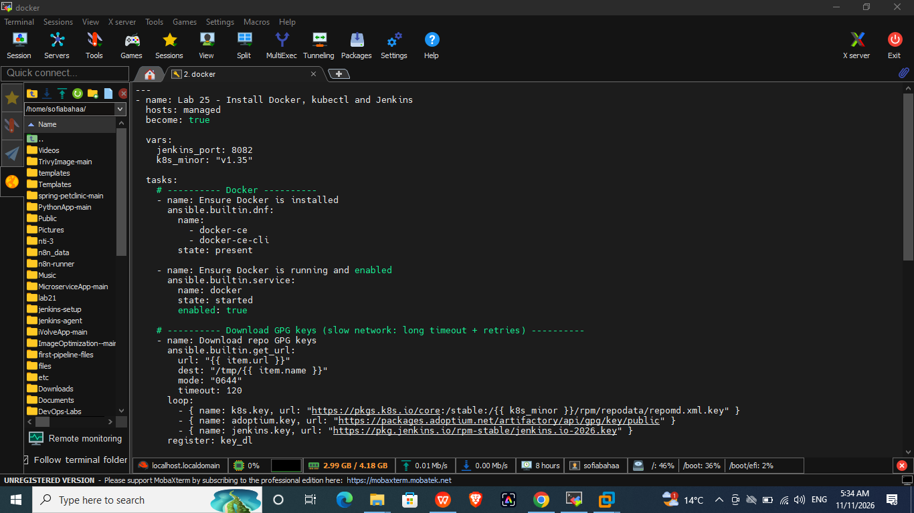
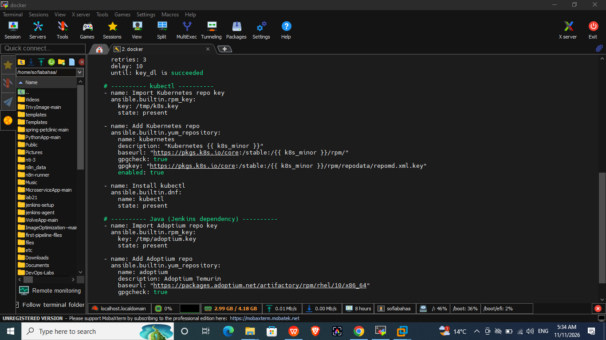
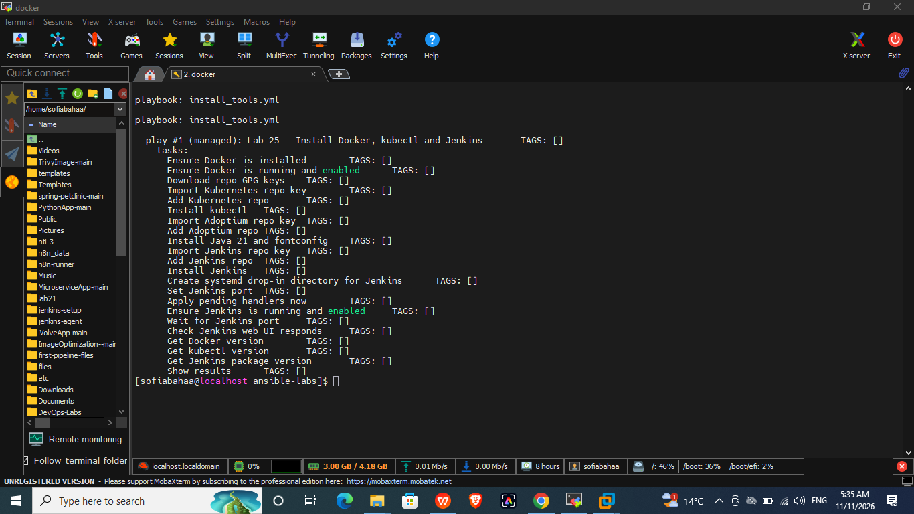
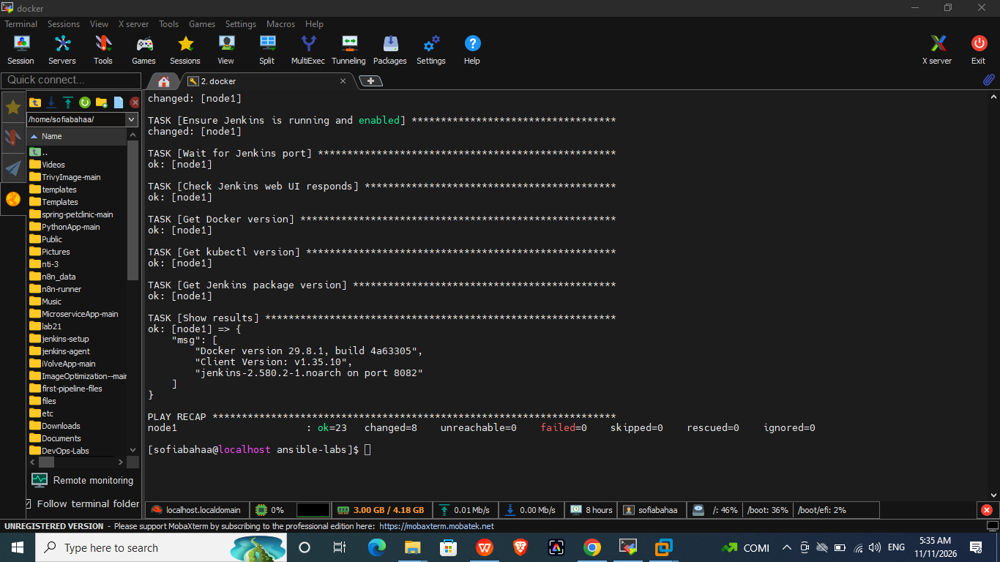
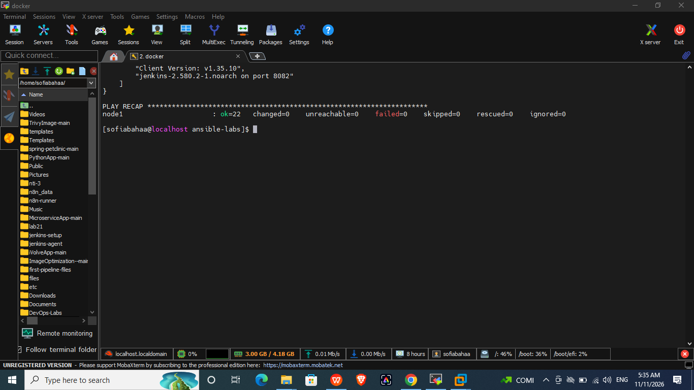
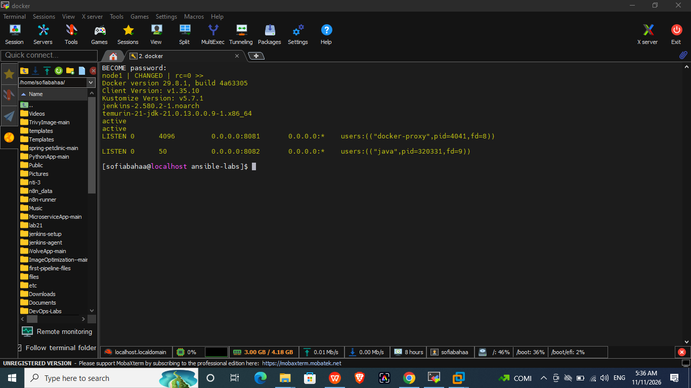
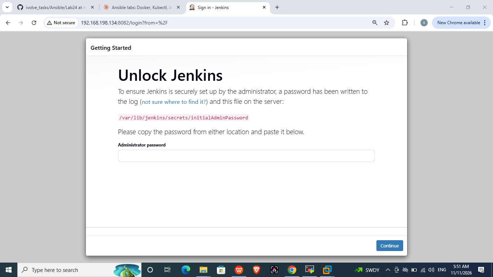

# Lab 25: Automated Tool Installation Using Ansible Playbooks

## Objective
Write an Ansible playbook that installs Docker, kubectl and Jenkins on the managed node, then verify the configuration.

## Environment
| Role | Host | OS | IP |
|------|------|----|----|
| Control node | RHEL VM | RHEL 10.1 | 192.168.198.134 |
| Managed node | `node1` (same VM, accessed over SSH) | RHEL 10.1 | 192.168.198.134 |

The inventory and `ansible.cfg` are the ones created in Lab 24.

## Playbook: `install_tools.yml`
The playbook runs with `become: true` and does the following:

1. **Docker**: ensures `docker-ce` and `docker-ce-cli` are installed, and the service is started and enabled.
2. **kubectl**: downloads the Kubernetes repo key, adds the `v1.35` repo and installs `kubectl`.
3. **Java 21**: adds the Adoptium (Temurin) repo and installs `temurin-21-jdk` and `fontconfig`, required by Jenkins.
4. **Jenkins**: adds the Jenkins `rpm-stable` repo, installs Jenkins, sets its port to `8082` with a systemd drop-in, and starts and enables the service.
5. **Verification**: waits for port 8082, checks that the Jenkins login page returns HTTP 200, prints the Docker, kubectl and Jenkins versions.




## Run
```bash
ansible-playbook install_tools.yml --syntax-check
ansible-playbook install_tools.yml --list-tasks
ansible-playbook install_tools.yml -K
```


First run result: Java, Jenkins, the repos and the systemd override were installed (`changed=8`, `failed=0`).


Second run result: `changed=0`, which shows that the playbook is idempotent.


## Verification on the managed node
```bash
ansible managed -b -K -m ansible.builtin.shell -a "docker --version; /usr/bin/kubectl version --client; rpm -q jenkins temurin-21-jdk; systemctl is-active jenkins docker; ss -tlnp | grep -E ':8081|:8082'"
```


Jenkins UI (Unlock page) on port 8082:


## Design decisions and issues
- **Jenkins port 8082**: the control node already runs a Jenkins container on 8081 and a Kind cluster on 8080, so the native Jenkins was moved to 8082.
- **Slow network**: the `rpm_key` module timed out while fetching the repo keys. The keys are now downloaded first with `get_url` (timeout 120 and retries), then imported from `/tmp`.
- **Jenkins signing key**: installing Jenkins failed with a GPG signature error because the old 2023 key no longer matches the packages. The fix was to use the `rpm-stable` repo URL and the `jenkins.io-2026.key` key.
- **RHEL not registered**: no Red Hat repos are available, so the playbook adds the Kubernetes, Adoptium and Jenkins repos itself.
- **kubectl**: installed from the official repo to `/usr/bin/kubectl`. Version `v1.35` matches the Kubernetes cluster version.
