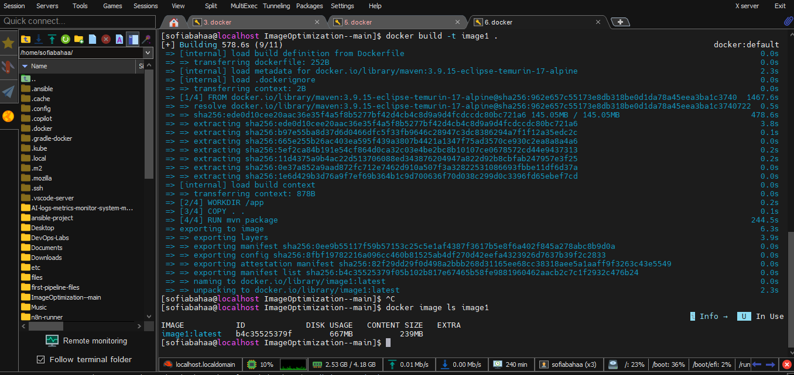
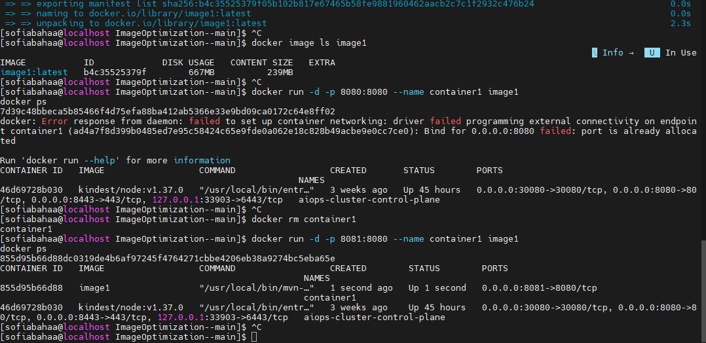
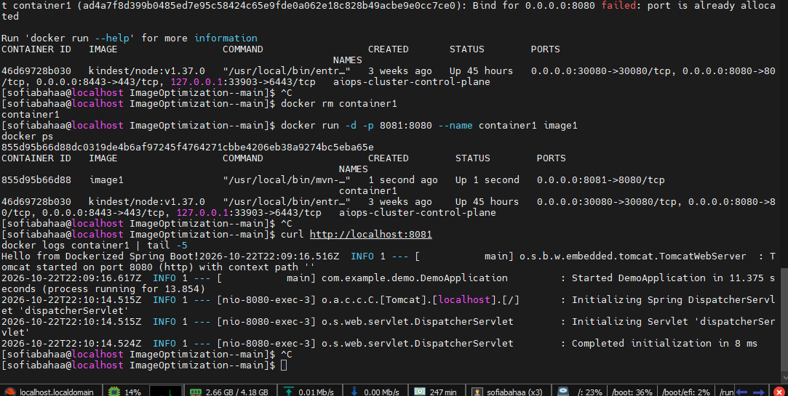
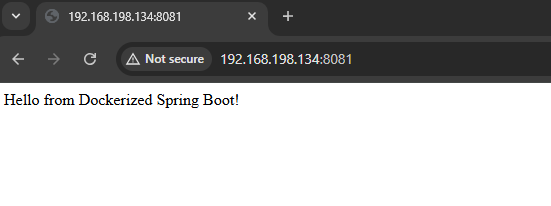
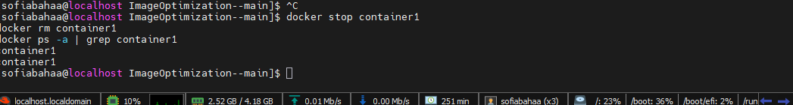
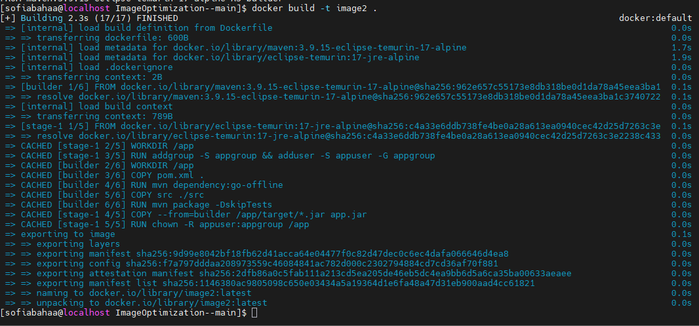
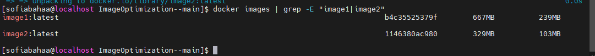
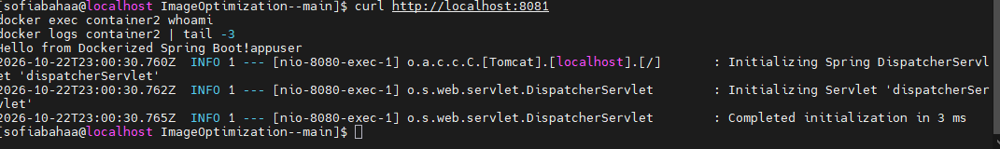

# Lab 4: Docker Image Optimization and Export/Load

A Spring Boot application used to demonstrate Docker image optimization using multi-stage builds and non-root user configuration.

---

## Steps

### 1. Clone the Repository

```bash
git clone https://github.com/Ibrahim-Adel15/ImageOptimization-.git
cd ImageOptimization-
```


---

### 2. Build image1 from the existing Dockerfile

```bash
docker build -t image1 .
```


---

### 3. Check image1 size

```bash
docker image ls image1
```



> image1 size: **667 MB** (DISK USAGE), **239 MB** (CONTENT SIZE) — built with the full Maven + JDK image.

---

### 4. Run container1 from image1

```bash
docker run -d -p 8081:8080 --name container1 image1
docker ps
```

> **Note:** Port `8080` was already in use on my VM by another container, so I mapped the host port `8081` to the container's port `8080`. If your host port `8080` is free, use `-p 8080:8080`.



---

### 5. Verify the application is working

```bash
curl http://localhost:8081
docker logs container1 | tail -5
```



Or open the browser at `http://<VM-IP>:8081`:



---

### 6. Stop and delete container1

```bash
docker stop container1
docker rm container1
```



---

### 7. Write a multi-stage Dockerfile with non-root user

Replace the existing `Dockerfile` with a multi-stage build that uses a lightweight JRE-only base image and runs as a non-root user:

```dockerfile
FROM maven:3.9.15-eclipse-temurin-17-alpine AS builder
WORKDIR /app

COPY pom.xml .
RUN mvn dependency:go-offline

COPY src ./src
RUN mvn package -DskipTests

FROM eclipse-temurin:17-jre-alpine
WORKDIR /app

# Create non-root user
RUN addgroup -S appgroup && adduser -S appuser -G appgroup

# Copy only the JAR from builder
COPY --from=builder /app/target/*.jar app.jar

# Change ownership to non-root user
RUN chown -R appuser:appgroup /app

USER appuser

EXPOSE 8080

CMD ["java", "-jar", "app.jar"]
```


---

### 8. Build image2 from the optimized Dockerfile

```bash
docker build -t image2 .
```



---

### 9. Compare image1 vs image2 size

```bash
docker images | grep -E "image1|image2"
```



| Image  | Disk Usage | Content Size |
|--------|------------|--------------|
| image1 | 667 MB     | 239 MB       |
| image2 | 329 MB     | 103 MB       |

> image2 is **~50% smaller** (disk usage) thanks to the multi-stage build using a JRE-only base image instead of the full Maven + JDK image.

---

### 10. Run container2 from image2 and verify non-root user

```bash
docker run -d -p 8081:8080 --name container2 image2
docker ps
```


Verify the application is working and the user is non-root:

```bash
curl http://localhost:8081; echo
docker exec container2 whoami
```



The output `appuser` confirms the container is running as a non-root user.

Browser check:


---

### 11. Stop and delete container2

```bash
docker stop container2
docker rm container2
```


---

### 12. Save image2 as a TAR file

```bash
docker save -o lab-image.tar image2
ls -lh lab-image.tar
```


---

### 13. Delete image2 from the local Docker host

```bash
docker rmi image2
docker images | grep image2
```


---

### 14. Load the image from the TAR file

```bash
docker load -i lab-image.tar
```


---

### 15. Verify the loaded image exists

```bash
docker images | grep image2
```


image2 is restored successfully on the local Docker host.

---

## Summary

| Step | Result |
|------|--------|
| image1 (single-stage, Maven + JDK) | 667 MB disk usage / 239 MB content size |
| image2 (multi-stage, JRE only, non-root) | 329 MB disk usage / 103 MB content size |
| Runtime user in container2 | `appuser` (non-root) |
| Exported TAR (`lab-image.tar`) | 99 MB |
| Load after delete | image2 restored successfully |
