# Lab 5: Docker Image Vulnerability Scanning with Trivy

A simple Node.js (Express) application used to demonstrate scanning a Docker image for vulnerabilities with **Trivy**, reading the scan reports, and remediating the findings.

---

## Steps

### 1. Clone the Repository

```bash
git clone https://github.com/Ibrahim-Adel15/TrivyImage.git
cd TrivyImage
```

---

### 2. Review the Dockerfile and build `trivy-lab:v1`

```bash
cat Dockerfile
docker build -t trivy-lab:v1 .
```

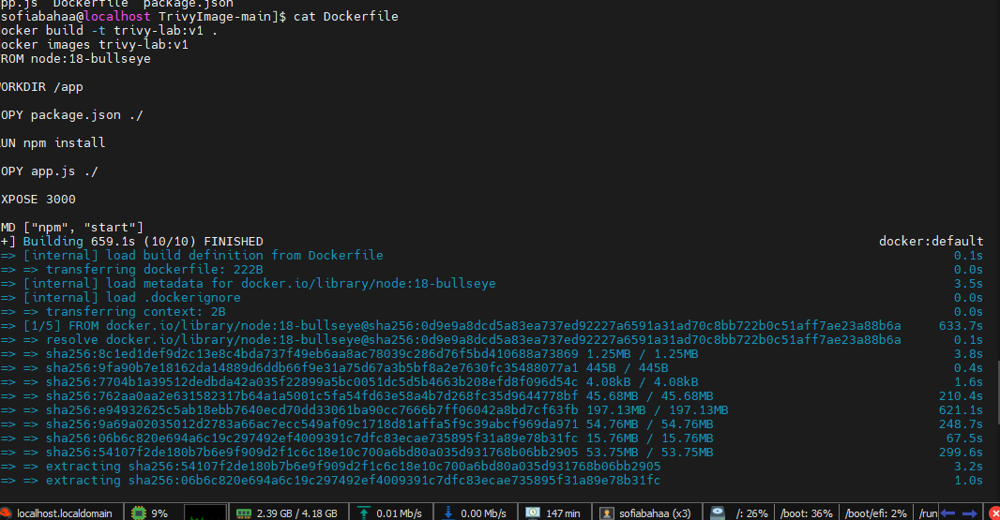

> The image is built from `node:18-bullseye` (Debian 11) and installs `express 4.18.2`.

---

### 3. Check the image

```bash
docker images trivy-lab:v1
```

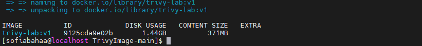

---

### 4. Install Trivy and verify the installation

```bash
curl -sfL https://raw.githubusercontent.com/aquasecurity/trivy/main/contrib/install.sh | sudo sh -s -- -b /usr/local/bin
trivy --version
```

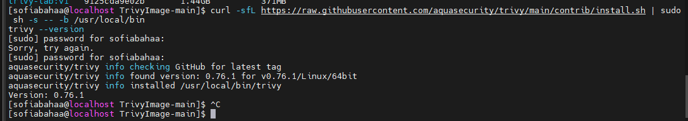

---

### 5. Scan the image for vulnerabilities

```bash
trivy image trivy-lab:v1
```

The first run downloaded the vulnerability database, then failed with `context deadline exceeded` because the default 5-minute timeout was too short on my VM. I limited the scan to vulnerabilities only and increased the timeout:

```bash
trivy image --scanners vuln --timeout 30m trivy-lab:v1
```

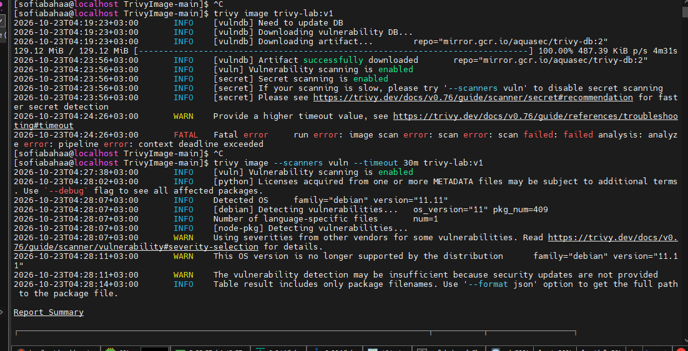

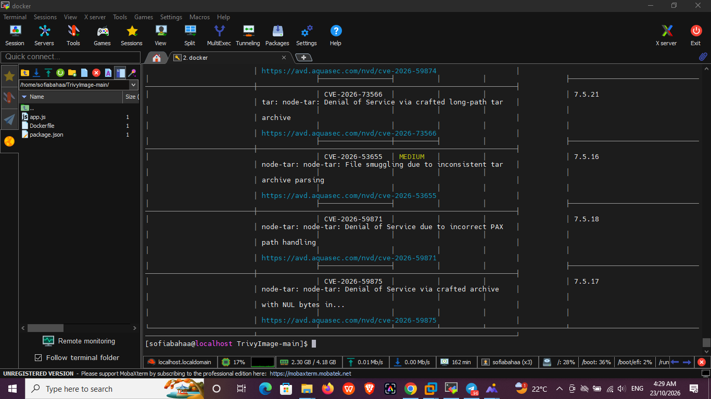

---

### 6. Scan for HIGH and CRITICAL vulnerabilities only

```bash
trivy image --scanners vuln --timeout 30m --severity HIGH,CRITICAL trivy-lab:v1
```

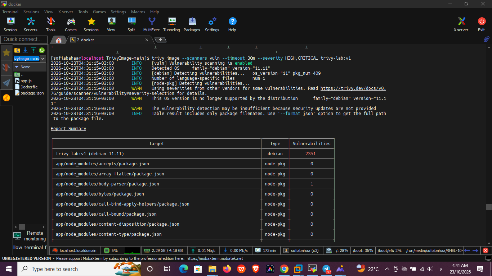

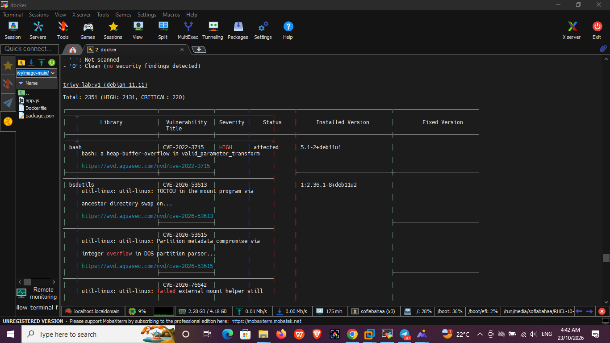

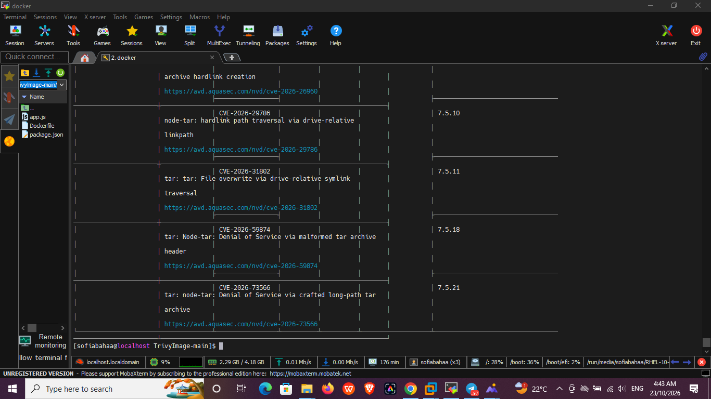

| Source | Total | HIGH | CRITICAL |
|--------|-------|------|----------|
| OS packages (Debian 11.11) | 2351 | 2131 | 220 |
| Node.js dependencies | 27 | 26 | 1 |

---

### 7. Generate an HTML vulnerability report

```bash
curl -sfL -o html.tpl https://raw.githubusercontent.com/aquasecurity/trivy/main/contrib/html.tpl
trivy image --format template --template "@html.tpl" -o report-v1.html trivy-lab:v1
ls -lh report-v1.html
```

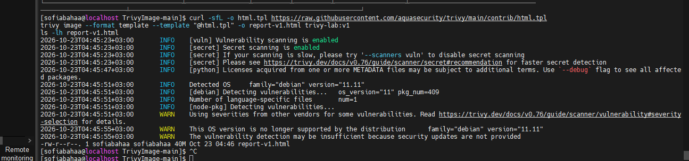

The full report (all severities) was **40 MB**, which is too heavy to open comfortably, so I regenerated it with HIGH and CRITICAL only (**9.4 MB**):

```bash
trivy image --scanners vuln --timeout 30m --severity HIGH,CRITICAL --format template --template "@html.tpl" -o report-v1.html trivy-lab:v1
```

Report opened in the browser (`report-v1.html`):

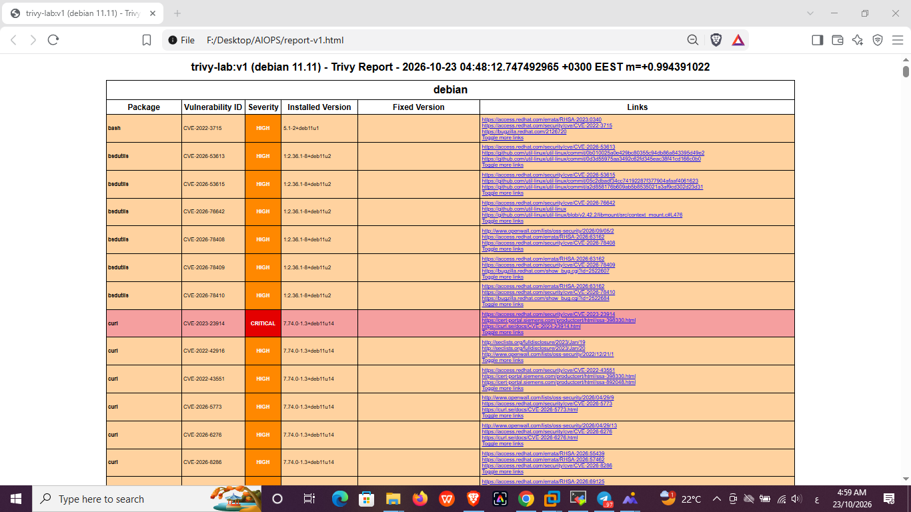

---

## Bonus: Vulnerability Remediation

### 8. Investigate the detected vulnerabilities

- Trivy warned that **Debian 11 is no longer supported** by its distribution, so security updates are not provided. The **Fixed Version** column is empty for the OS packages, so updating packages inside the image does not help.
- `node:18` is an end-of-life Node.js version.
- `express 4.18.2` is an old release.

Almost all findings (2351 of 2378) come from the **old base image**, so updating the base image is the most important fix.

---

### 9. Fix the issues (first round)

I kept the original files as `Dockerfile.v1` and `package.json.v1`, then updated the base image and the express version:

```bash
cp Dockerfile Dockerfile.v1
cp package.json package.json.v1
```

`Dockerfile`:

```dockerfile
FROM node:22-alpine

WORKDIR /app

COPY package.json ./

RUN npm install --omit=dev

COPY app.js ./

EXPOSE 3000

CMD ["npm", "start"]
```

`package.json`:

```json
{
  "name": "trivy-lab",
  "version": "1.0.0",
  "description": "A simple Node.js application for Trivy scanning",
  "main": "app.js",
  "scripts": {
    "start": "node app.js"
  },
  "dependencies": {
    "express": "^4.21.2"
  }
}
```

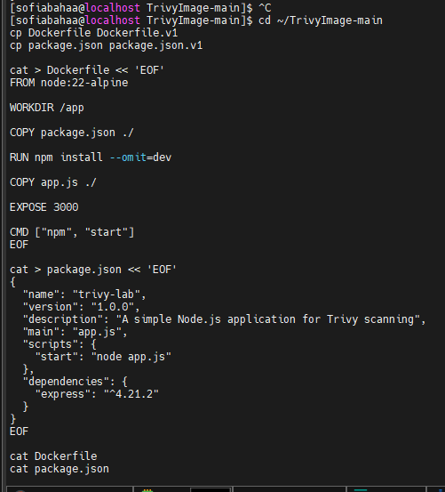

| Change | Why |
|--------|-----|
| `node:18-bullseye` → `node:22-alpine` | Supported Node.js version, and Alpine ships far fewer packages than Debian |
| `express 4.18.2` → `^4.21.2` | Picks up the security fixes of the 4.x line |
| `npm install --omit=dev` | Does not install dev dependencies |

---

### 10. Rebuild the image and tag it as `ivolve-app:v2`

```bash
docker build -t ivolve-app:v2 .
docker images | grep -E "trivy-lab|ivolve-app"
```

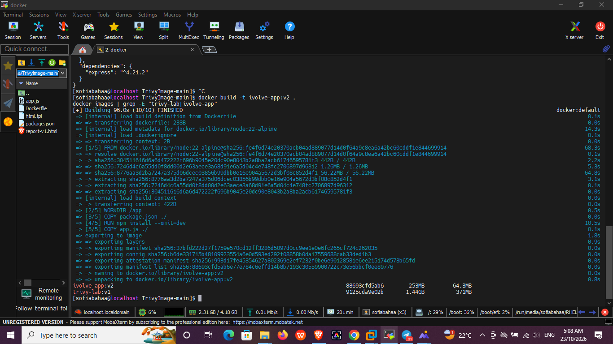

The new image is much smaller than the original (**253 MB** vs **1.44 GB**).

Verify the application still works:

```bash
docker run -d -p 3001:3000 --name ivolve-test ivolve-app:v2
sleep 3
curl http://localhost:3001; echo
docker stop ivolve-test && docker rm ivolve-test
```

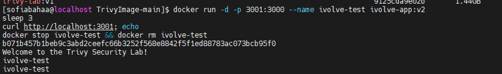

---

### 11. Rescan the updated image

```bash
trivy image --scanners vuln --timeout 30m --severity HIGH,CRITICAL ivolve-app:v2
```

The OS packages and the application dependencies (`express` and its modules) are clean:

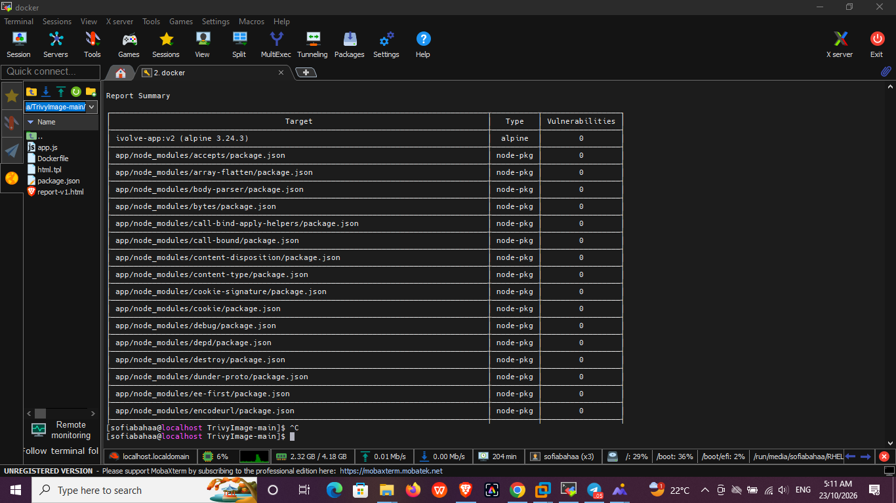

But **11 HIGH vulnerabilities** were still reported:

```bash
trivy image --scanners vuln --timeout 30m --severity HIGH,CRITICAL ivolve-app:v2 2>/dev/null | grep "Total"
```

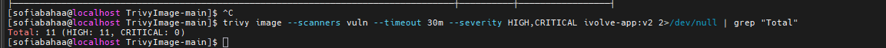

An HTML report was generated for this stage:

```bash
trivy image --scanners vuln --timeout 30m --severity HIGH,CRITICAL --format template --template "@html.tpl" -o report-v2.html ivolve-app:v2
ls -lh report-v2.html
```

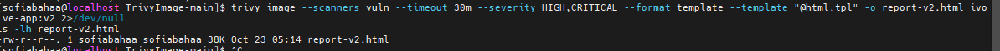

The remaining findings are in packages bundled with the **npm CLI** inside the base image (`brace-expansion`, `pacote`, `picomatch`, `sigstore`, `ip-address`, `http-cache-semantics`), not in the application's own dependencies:

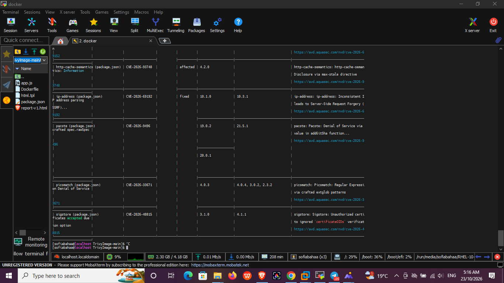

---

### 12. Fix the remaining issues (second round)

Most of these have a fixed version, so I updated npm itself in the `Dockerfile`:

```dockerfile
FROM node:22-alpine

# Update npm to pick up patched bundled dependencies
RUN npm install -g npm@latest

WORKDIR /app

COPY package.json ./

RUN npm install --omit=dev

COPY app.js ./

EXPOSE 3000

CMD ["npm", "start"]
```

Rebuild `ivolve-app:v2`:

```bash
docker build -t ivolve-app:v2 .
```

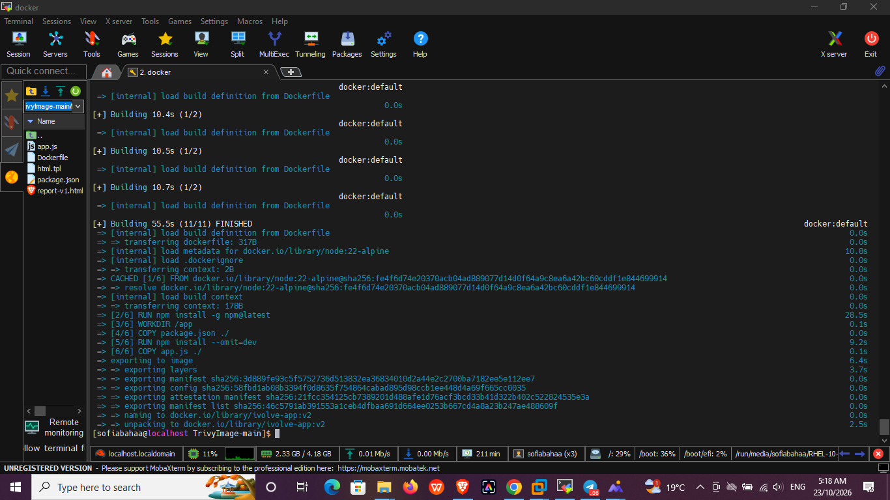

---

### 13. Rescan and generate the final HTML report

```bash
trivy image --scanners vuln --timeout 30m --severity HIGH,CRITICAL --format template --template "@html.tpl" -o report-v2.html ivolve-app:v2
```

The final report shows **No Vulnerabilities found** for both `alpine` and `node-pkg`:

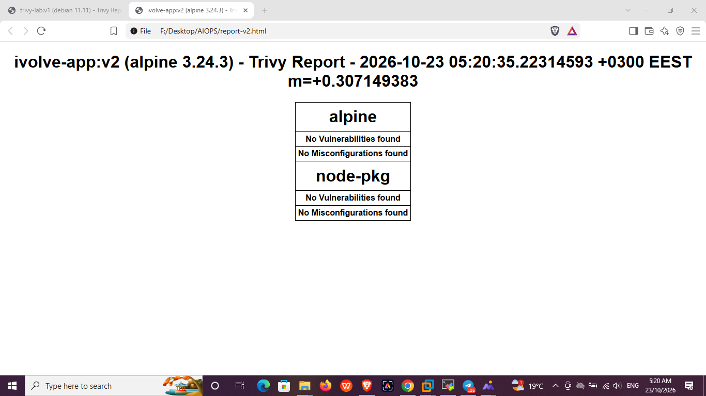

---

## Summary

| | `trivy-lab:v1` | `ivolve-app:v2` |
|---|---|---|
| Base image | `node:18-bullseye` (Debian 11, EOL) | `node:22-alpine` |
| express | 4.18.2 | ^4.21.2 |
| npm | bundled with Node 18 | updated (`npm@latest`) |
| HIGH + CRITICAL (OS packages) | 2351 | 0 |
| HIGH + CRITICAL (Node.js) | 27 | 0 |
| HTML report | `report-v1.html` | `report-v2.html` |
