# Lab 6: Docker Environment Variables and Resource Management

A small Flask application that reads two environment variables (`APP_NAME` and `APP_ENV`) and returns them as JSON. The lab demonstrates passing environment variables to containers in three ways (`-e`, `--env-file`, and `ENV` in the Dockerfile) and limiting the CPU and memory of a container.

> The application raises an error and exits if `APP_NAME` or `APP_ENV` is missing, so the variables must always be provided.

---

## Steps

### 1. Clone the application code

```bash
git clone https://github.com/Ibrahim-Adel15/PythonApp.git
cd PythonApp
cat requirements.txt
cat app.py
```

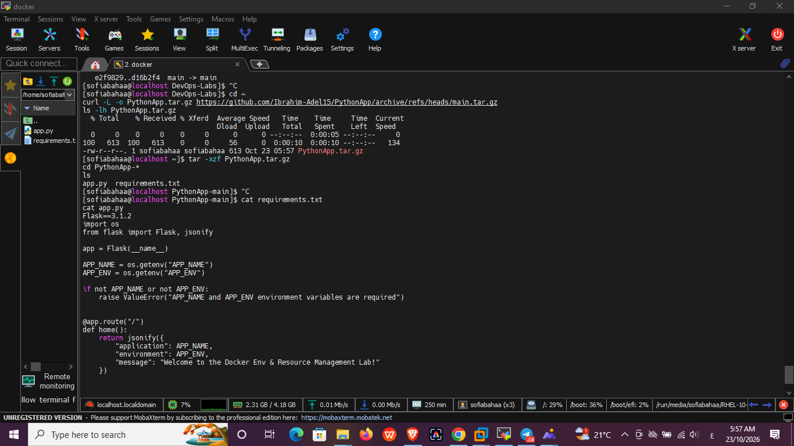

---

### 2. Create the Dockerfile and build `ivolve1`

```dockerfile
FROM python:3.12-slim

WORKDIR /app

COPY requirements.txt .
RUN pip install --no-cache-dir -r requirements.txt

COPY app.py .

EXPOSE 5000

CMD ["python", "app.py"]
```

```bash
docker build -t ivolve1 .
docker images ivolve1
```

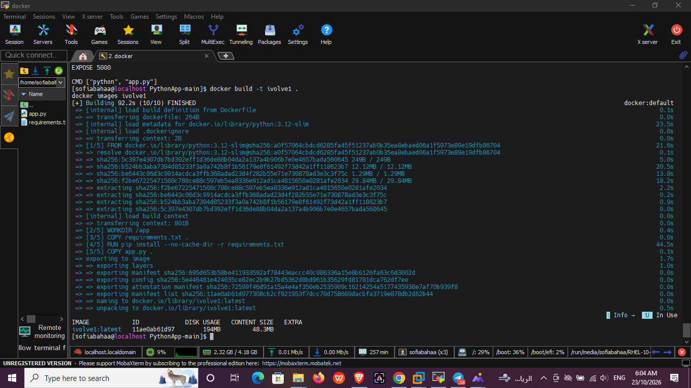

---

### 3. Run `container1` with environment variables and resource limits

`container1` maps port 5000, sets `APP_NAME=iVolveApp1` and `APP_ENV=stg`, and is limited to **1 CPU** and **256 MB** of memory:

```bash
docker run -d --name container1 -p 5000:5000 \
  -e APP_NAME=iVolveApp1 -e APP_ENV=stg \
  --cpus 1 --memory 256m ivolve1
docker ps
```

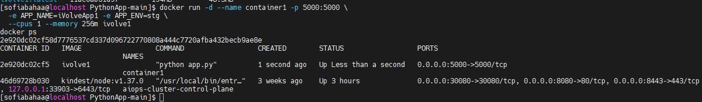

---

### 4. Verify the application is working

Open `http://<VM-IP>:5000` in the browser (or use `curl http://localhost:5000`):

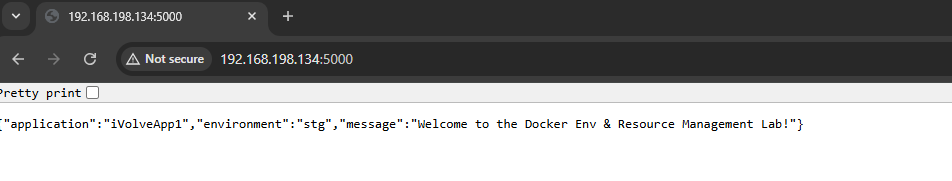

---

### 5. Verify the environment variables inside the container

```bash
docker exec container1 env | grep APP_
```

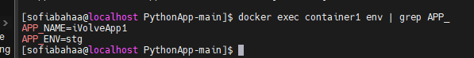

---

### 6. Monitor CPU and memory usage

```bash
docker stats --no-stream container1
```

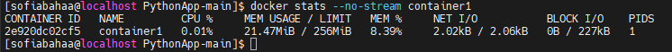

The memory limit shows as `256MiB`. The resource limits can also be checked from the container configuration (1 CPU = `1000000000` NanoCpus, 256 MB = `268435456` bytes):

```bash
docker inspect container1 --format 'CPUs={{.HostConfig.NanoCpus}} Memory={{.HostConfig.Memory}}'
```

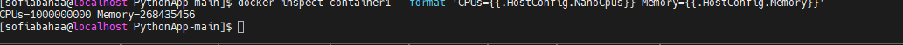

---

### 7. Create `env.txt`

First stop and remove `container1` so that port 5000 is free:

```bash
docker stop container1
docker rm container1

cat > env.txt << 'EOF'
APP_NAME=iVolveApp2
APP_ENV=prod
EOF
cat env.txt
```

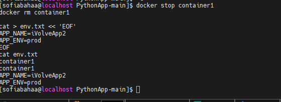

---

### 8. Run `container2` and load the variables from `env.txt`

```bash
docker run -d --name container2 -p 5000:5000 --env-file env.txt ivolve1
sleep 3
curl http://localhost:5000; echo
docker exec container2 env | grep APP_
```

> A few seconds are needed for Flask to start. An immediate `curl` right after `docker run` returns `Connection reset by peer`.

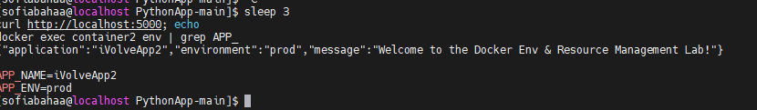

Stop and remove `container2` before the next step:

```bash
docker stop container2
docker rm container2
```

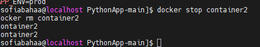

---

### 9. Create a new image with the variables hardcoded in the Dockerfile

`Dockerfile.env`:

```dockerfile
FROM python:3.12-slim

WORKDIR /app

ENV APP_NAME=iVolveApp3
ENV APP_ENV=dev

COPY requirements.txt .
RUN pip install --no-cache-dir -r requirements.txt

COPY app.py .

EXPOSE 5000

CMD ["python", "app.py"]
```

```bash
docker build -f Dockerfile.env -t ivolve3 .
docker images ivolve3
```

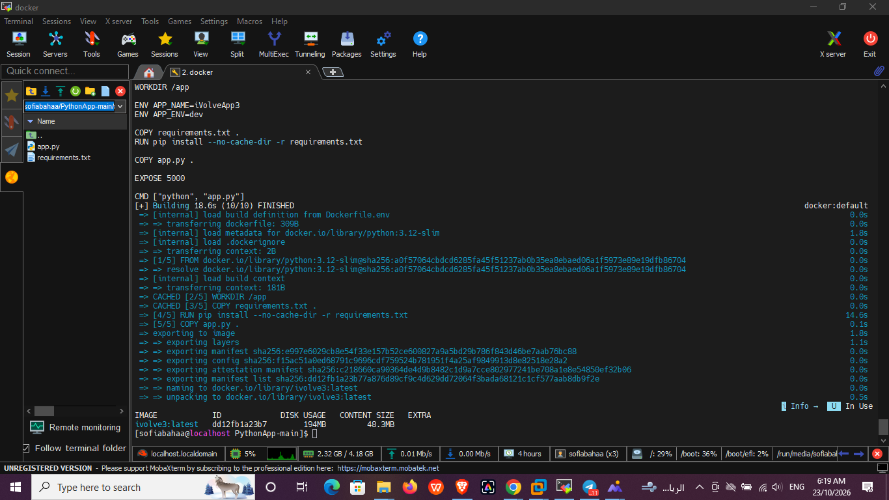

---

### 10. Run a container from `ivolve3` and validate the variables

The lab names this container `container2` again; since the previous `container2` was removed, the same name is reused. No `-e` or `--env-file` is used, so the values come from the Dockerfile:

```bash
docker run -d --name container2 -p 5000:5000 ivolve3
docker ps
```

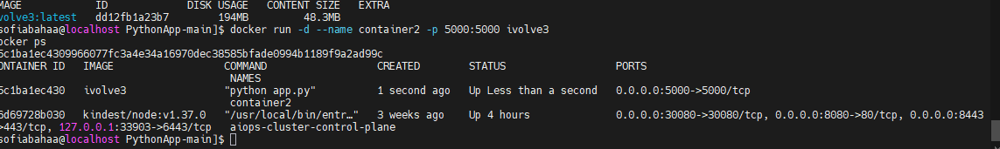

```bash
sleep 3
curl http://localhost:5000; echo
docker exec container2 env | grep APP_
```

The output shows `iVolveApp3` and `dev`:

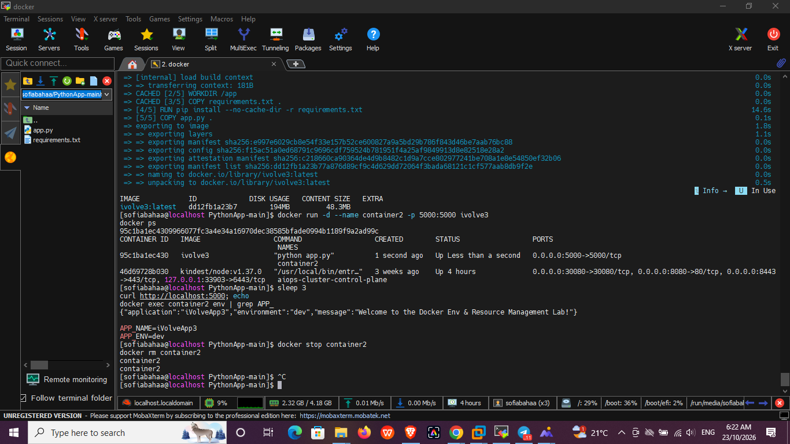

Clean up:

```bash
docker stop container2
docker rm container2
```

---

## Summary

| Container | Image | How the variables were set | APP_NAME | APP_ENV |
|-----------|-------|----------------------------|----------|---------|
| `container1` | `ivolve1` | `-e` flags (1 CPU, 256 MB limit) | iVolveApp1 | stg |
| `container2` | `ivolve1` | `--env-file env.txt` | iVolveApp2 | prod |
| `container2` | `ivolve3` | `ENV` in `Dockerfile.env` | iVolveApp3 | dev |

> **Note:** the lab text says `docker stats cont1`; the container was named `container1`, so that name was used.
