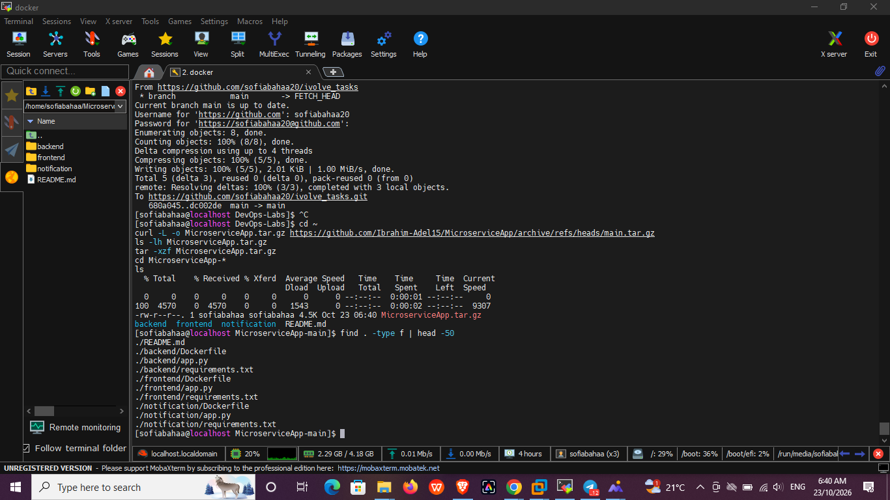
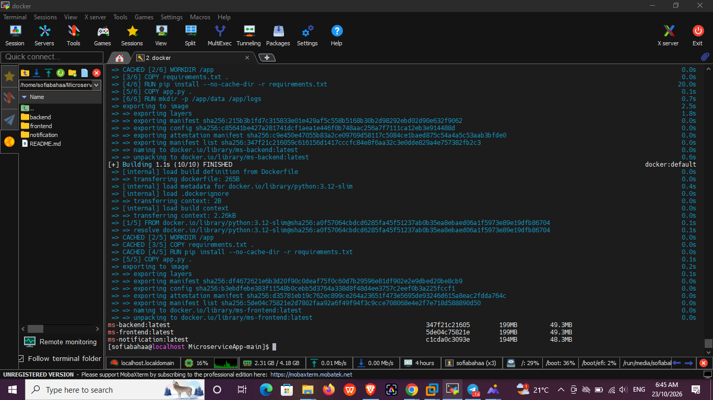
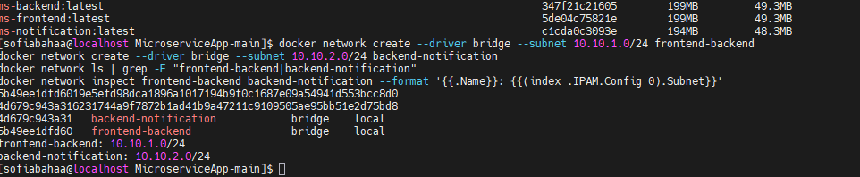
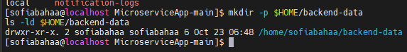
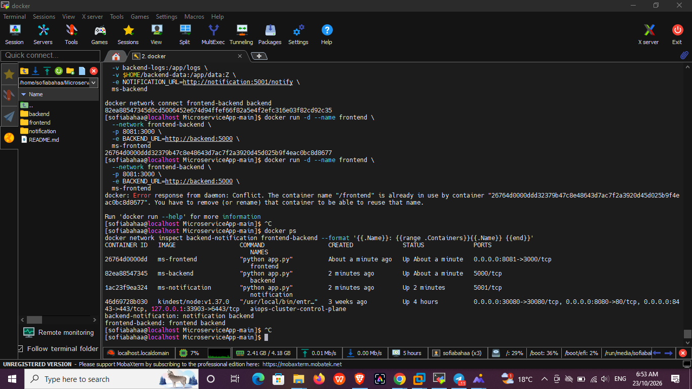
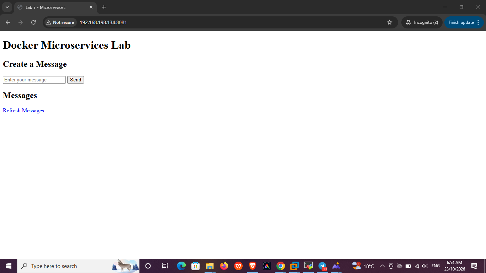
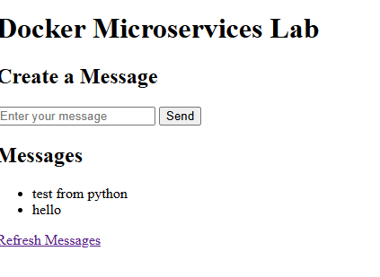
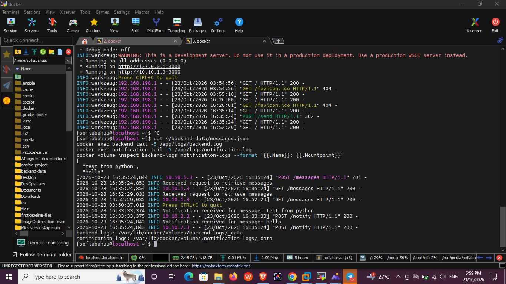
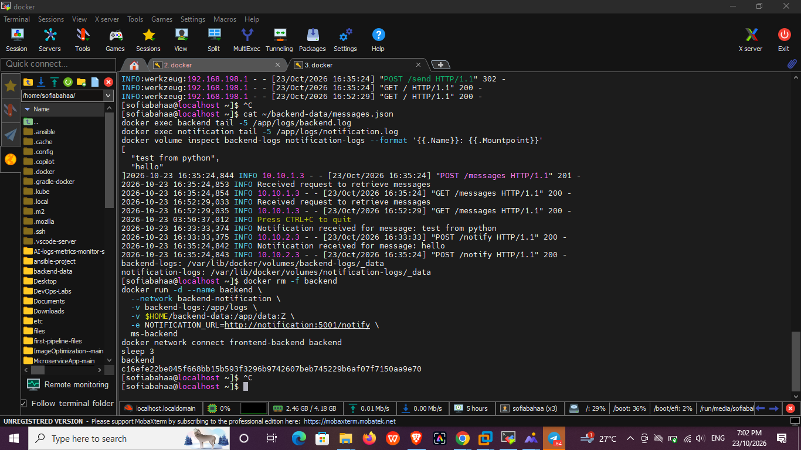
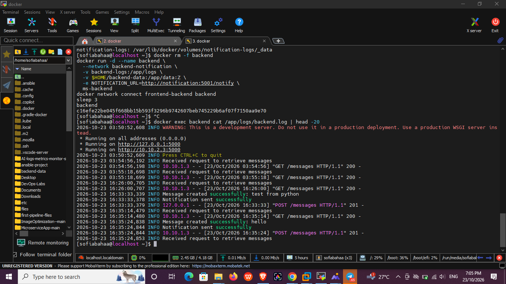

# Lab 7: Docker Microservices (Networks, Volumes and Bind Mounts)

This lab deploys a three-service microservice application using Docker:

| Service | Image | Port | Networks | Storage |
|---|---|---|---|---|
| frontend | `ms-frontend` | `8081 -> 3000` | `frontend-backend` | none |
| backend | `ms-backend` | `5000` (internal only) | `frontend-backend`, `backend-notification` | volume `backend-logs`, bind mount `~/backend-data` |
| notification | `ms-notification` | `5001` (internal only) | `backend-notification` | volume `notification-logs` |

**Network isolation:** the frontend can reach only the backend, and the notification service is reachable only from the backend.

**Storage:**
- Named volumes (`backend-logs`, `notification-logs`) keep the application logs.
- A bind mount (`~/backend-data` -> `/app/data`) keeps the messages on the host, so they survive container removal.

---

## 1. Get the application code

```bash
cd ~
curl -L -o MicroserviceApp.tar.gz https://github.com/Ibrahim-Adel15/MicroserviceApp/archive/refs/heads/main.tar.gz
tar -xzf MicroserviceApp.tar.gz
cd MicroserviceApp-*
find . -type f | head -50
```

The project contains three services (`backend`, `frontend`, `notification`), each with its own `Dockerfile`, `app.py` and `requirements.txt`.



---

## 2. Build the images

Each service uses `python:3.12-slim`, installs its requirements, copies `app.py`, and creates the `/app/data` and `/app/logs` directories.

```bash
docker build -t ms-backend ./backend
docker build -t ms-frontend ./frontend
docker build -t ms-notification ./notification
docker images | grep ms-
```



---

## 3. Create the networks

Two custom bridge networks with fixed subnets:

```bash
docker network create --driver bridge --subnet 10.10.1.0/24 frontend-backend
docker network create --driver bridge --subnet 10.10.2.0/24 backend-notification
docker network ls | grep -E "frontend-backend|backend-notification"
docker network inspect frontend-backend backend-notification --format '{{.Name}}: {{(index .IPAM.Config 0).Subnet}}'
```



---

## 4. Create the bind mount directory on the host

```bash
mkdir -p $HOME/backend-data
ls -ld $HOME/backend-data
```



---

## 5. Create the volumes and run the containers

```bash
docker volume create backend-logs
docker volume create notification-logs
```

**Notification**

```bash
docker run -d --name notification \
  --network backend-notification \
  -v notification-logs:/app/logs \
  ms-notification
```

**Backend** (starts on `backend-notification`, then is also connected to `frontend-backend`)

```bash
docker run -d --name backend \
  --network backend-notification \
  -v backend-logs:/app/logs \
  -v $HOME/backend-data:/app/data:Z \
  -e NOTIFICATION_URL=http://notification:5001/notify \
  ms-backend

docker network connect frontend-backend backend
```

**Frontend**

```bash
docker run -d --name frontend \
  --network frontend-backend \
  -p 8081:3000 \
  -e BACKEND_URL=http://backend:5000 \
  ms-frontend
```

> The `:Z` flag sets the SELinux label so the container can write to the host directory on RHEL.

---

## 6. Verify the containers and networks

```bash
docker ps
docker network inspect backend-notification frontend-backend --format '{{.Name}}: {{range .Containers}}{{.Name}} {{end}}'
```

Result: `backend-notification` contains `notification` and `backend`, and `frontend-backend` contains `frontend` and `backend`.



---

## 7. Open the application

Open `http://192.168.198.134:8081` in the browser.



---

## 8. Send messages

Type messages in the form and press **Send**. The messages appear under **Messages**.



---

## 9. Verify the bind mount, logs and volumes

```bash
cat ~/backend-data/messages.json
docker exec backend tail -5 /app/logs/backend.log
docker exec notification tail -5 /app/logs/notification.log
docker volume inspect backend-logs notification-logs --format '{{.Name}}: {{.Mountpoint}}'
```

- `messages.json` on the host contains the messages (bind mount works).
- The backend log shows `POST /messages 201`.
- The notification log shows `Notification received for message: hello` (backend reached notification over `backend-notification`).
- Both volumes exist under `/var/lib/docker/volumes/`.



---

## 10. Persistence test: remove and recreate the backend

```bash
docker rm -f backend
docker run -d --name backend \
  --network backend-notification \
  -v backend-logs:/app/logs \
  -v $HOME/backend-data:/app/data:Z \
  -e NOTIFICATION_URL=http://notification:5001/notify \
  ms-backend
docker network connect frontend-backend backend
sleep 3
```



---

## 11. Verify the old logs survived

```bash
docker exec backend cat /app/logs/backend.log | head -20
```

The log still contains entries from before the container was deleted (for example `Message created successfully: test from python` and `hello`), so the named volume preserved the logs.



---

## 12. Verify the messages survived

After recreating the backend, refresh `http://192.168.198.134:8081`. The previous messages (`test from python`, `hello`) are still displayed because they are stored in `~/backend-data` on the host.

<!-- TODO: add screenshot of the page after recreating the backend, then uncomment:

-->

---

## Summary

| Requirement | Result |
|---|---|
| Custom networks with fixed subnets | `frontend-backend` (10.10.1.0/24), `backend-notification` (10.10.2.0/24) |
| Network isolation | frontend and notification are on separate networks; only backend joins both |
| Named volumes for logs | `backend-logs`, `notification-logs` |
| Bind mount for data | `~/backend-data` -> `/app/data` |
| Data persists after container removal | Verified |
