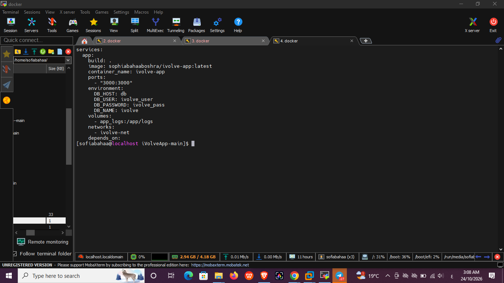
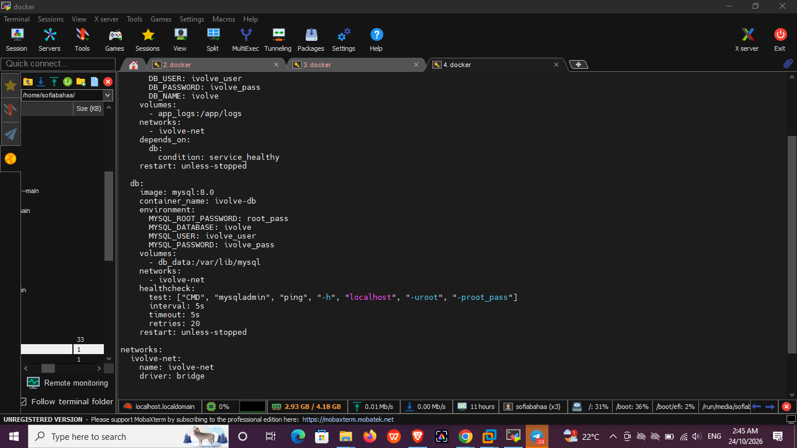
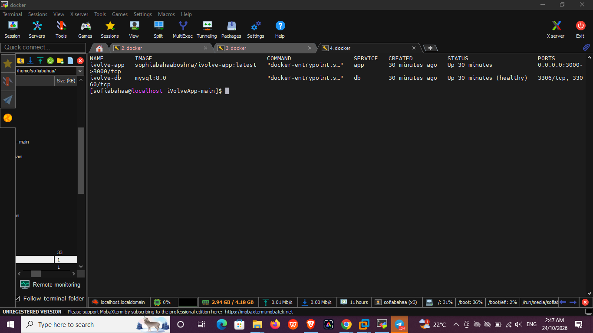
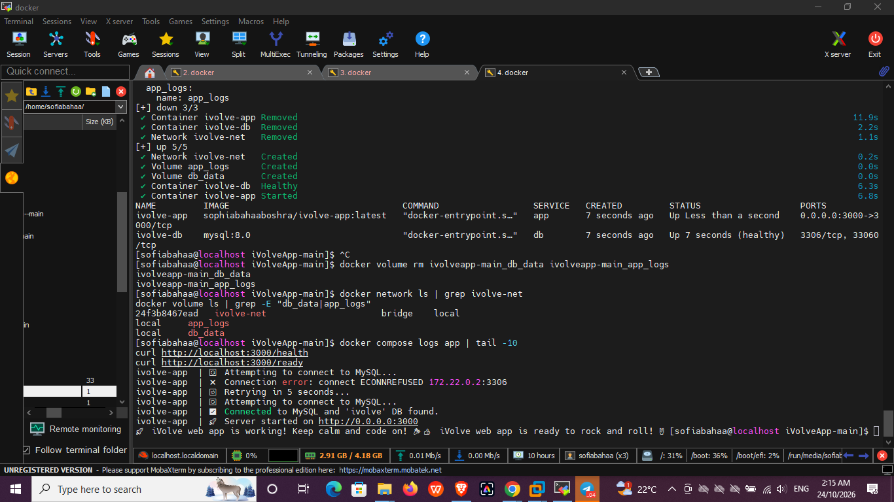
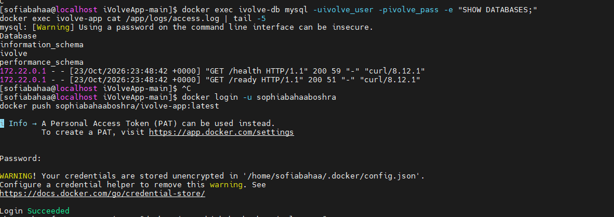
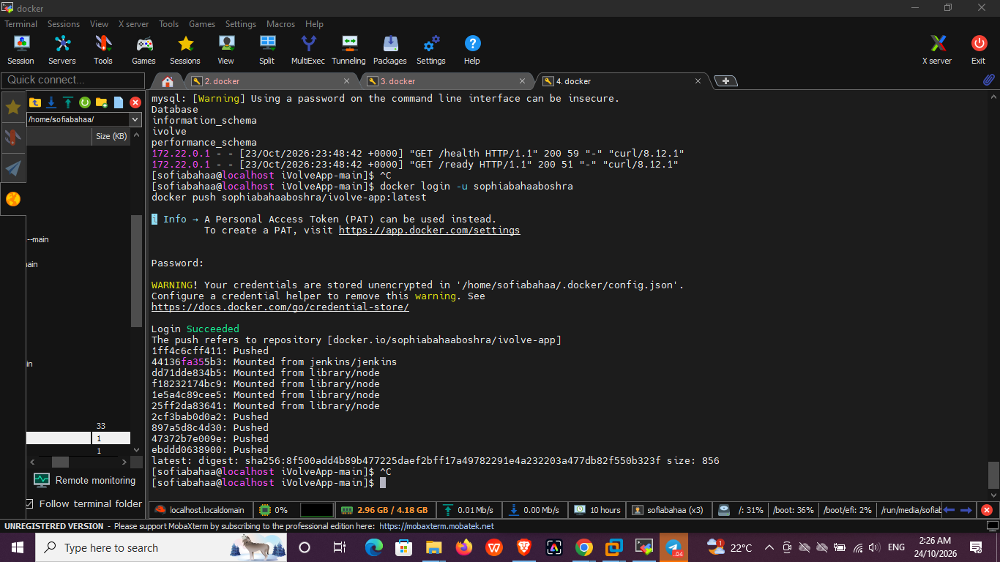

# Lab 8: Containerized Node.js and MySQL Stack Using Docker Compose

This lab runs the iVolve Node.js application together with a MySQL database using Docker Compose.

| Service | Image | Port | Storage |
|---|---|---|---|
| app | built from `Dockerfile` (`node:18-alpine`) | `3000:3000` | volume `app_logs` -> `/app/logs` |
| db | `mysql:8.0` | internal `3306` | volume `db_data` -> `/var/lib/mysql` |

Both services are attached to a custom bridge network named `ivolve-net`.

The application needs a MySQL connection and a database named `ivolve`, so the `db` service creates it with `MYSQL_DATABASE=ivolve`. The `app` service waits until the database is healthy (`depends_on` with `condition: service_healthy`).

---

## 1. Get the application code

```bash
cd ~
curl -L -o iVolveApp.tar.gz https://github.com/Ibrahim-Adel15/iVolveApp/archive/refs/heads/main.tar.gz
tar -xzf iVolveApp.tar.gz
cd iVolveApp-main
ls
```


---

## 2. Create `docker-compose.yml`

```bash
cat docker-compose.yml
```

Key points:
- `app` builds from the local `Dockerfile`, maps port 3000, receives `DB_HOST`, `DB_USER`, `DB_PASSWORD`, `DB_NAME`, and mounts `app_logs` at `/app/logs`.
- `db` uses `mysql:8.0` with `MYSQL_ROOT_PASSWORD`, `MYSQL_DATABASE`, `MYSQL_USER`, `MYSQL_PASSWORD`, and mounts `db_data` at `/var/lib/mysql`.
- A custom network `ivolve-net` connects both services.





---

## 3. Start the services

```bash
docker compose up -d --build
docker compose ps
```

`ivolve-db` becomes `healthy` and `ivolve-app` is `Up` on port 3000.



---

## 4. Verify the network and volumes

```bash
docker network ls | grep ivolve-net
docker volume ls | grep -E "db_data|app_logs"
```


---

## 5. Verify the application and the database connection

```bash
docker compose logs app | tail -10
curl http://localhost:3000/health
curl http://localhost:3000/ready
```

The log shows `Connected to MySQL and 'ivolve' DB found` and the health endpoints return success. (The first `ECONNREFUSED` line is the app retrying while MySQL was still starting.)



---

## 6. Open the application in the browser

Open `http://192.168.198.134:3000`.


---

## 7. Verify the database and the persisted logs

```bash
docker exec ivolve-db mysql -uivolve_user -pivolve_pass -e "SHOW DATABASES;"
docker exec ivolve-app cat /app/logs/access.log | tail -5
```

The `ivolve` database exists, and `access.log` is stored in the `app_logs` volume.



---

## 8. Push the image to Docker Hub

```bash
docker login -u sophiabahaaboshra
docker push sophiabahaaboshra/ivolve-app:latest
```



---

## 9. Verify the image on Docker Hub

Repository: https://hub.docker.com/r/sophiabahaaboshra/ivolve-app


---

<!-- Optional persistence test. Uncomment after adding images/step_10.png

## 10. Persistence test

```bash
docker compose down
docker compose up -d
docker exec ivolve-app cat /app/logs/access.log | head -5
docker exec ivolve-db mysql -uivolve_user -pivolve_pass -e "USE ivolve; SELECT * FROM products;"
```


-->

## Summary

| Requirement | Result |
|---|---|
| App built from Dockerfile, port 3000 mapped | Done |
| DB environment variables configured | Done |
| Custom network `ivolve-net` | Done |
| Logs persisted at `/app/logs/` | Volume `app_logs` |
| DB data persisted at `/var/lib/mysql` | Volume `db_data` |
| App connected to DB | Verified (`/health`, `/ready`) |
| Image pushed to Docker Hub | `sophiabahaaboshra/ivolve-app:latest` |
