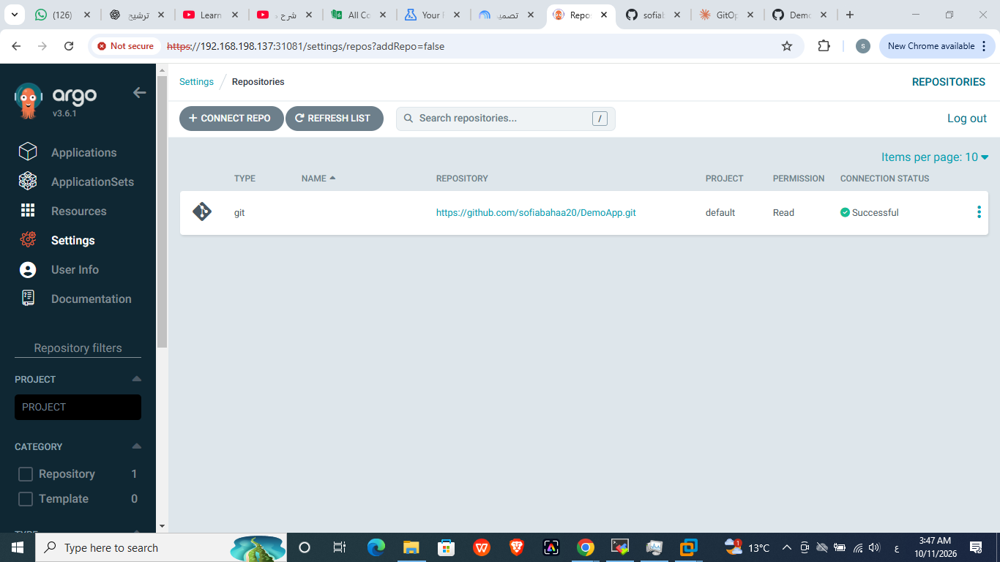
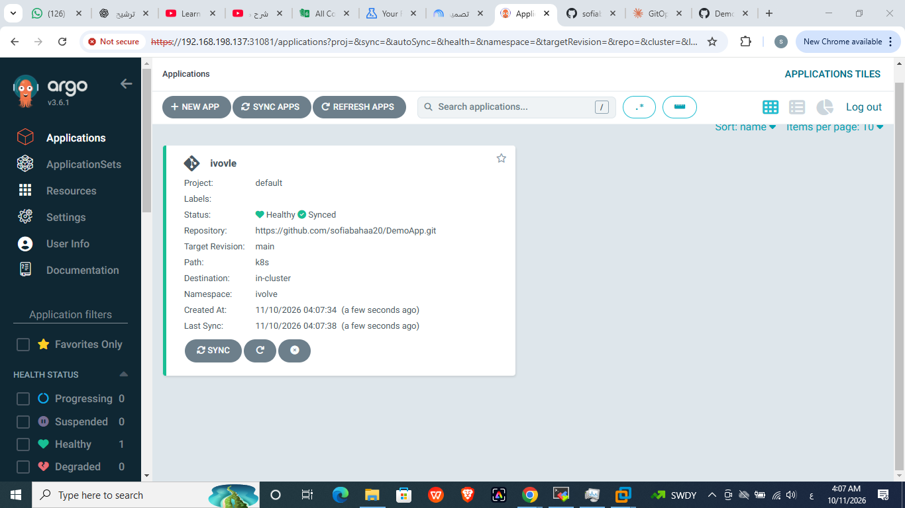
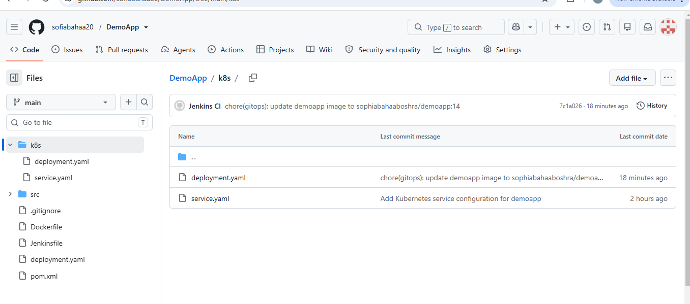
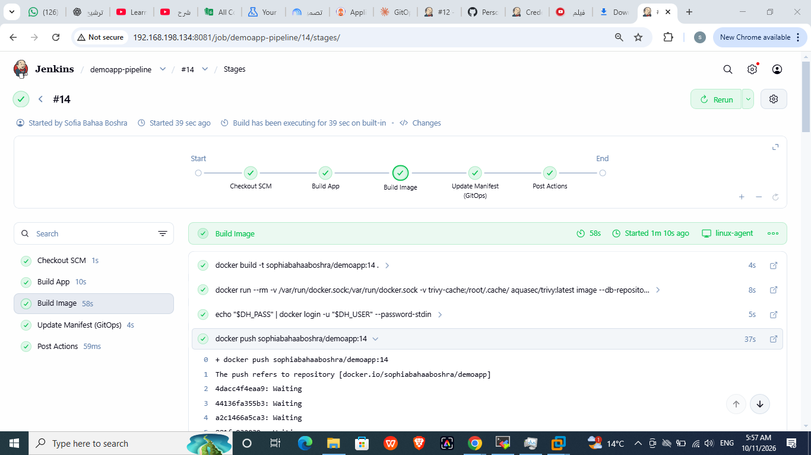
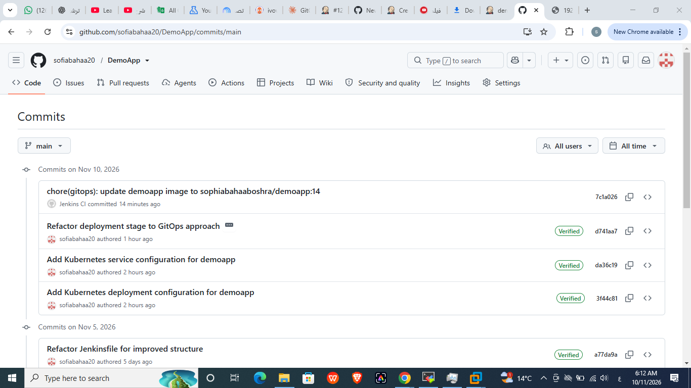
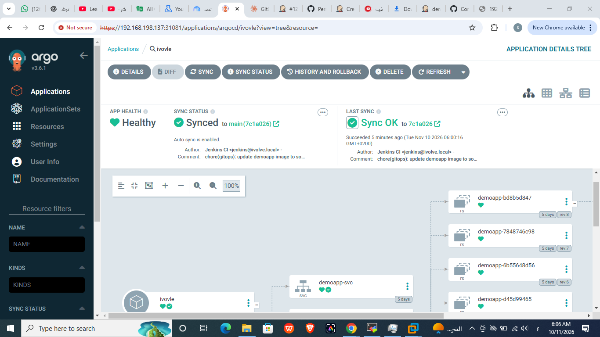
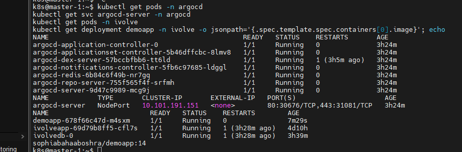
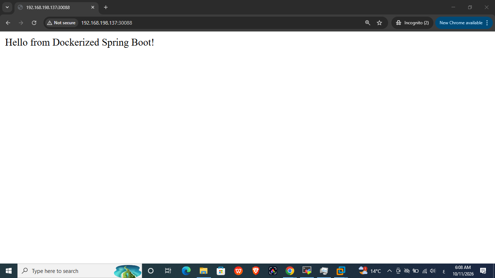

# Lab 23: Implementing a GitOps Workflow with Jenkins and Argo CD

## 1. Overview
GitOps CD workflow: Jenkins builds and publishes the image and updates the
manifest in Git, and Argo CD (auto-sync) applies the change to the Kubernetes
cluster (master-1 / worker-1, namespace `ivolve`).

Flow: Jenkins build -> push image to Docker Hub -> Jenkins commits the new image
tag to `k8s/deployment.yaml` -> Argo CD detects the commit -> auto-sync -> rollout.

The manifests that Argo CD watches live in the `DemoApp` repo (`k8s/` folder):
https://github.com/sofiabahaa20/DemoApp. A copy is kept here in `k8s/`.

## 2. Install Argo CD
```bash
kubectl create namespace argocd
kubectl apply -n argocd --server-side --force-conflicts \
  -f https://raw.githubusercontent.com/argoproj/argo-cd/stable/manifests/install.yaml
kubectl get pods -n argocd
```
Note: the worker node had the taint `workload=ivolveApp:NoSchedule`, which kept
the Argo CD pods in Pending. It was removed with:
```bash
kubectl taint nodes worker-1 workload=ivolveApp:NoSchedule-
```

## 3. Access the UI
```bash
kubectl patch svc argocd-server -n argocd -p '{"spec": {"type": "NodePort"}}'
kubectl get svc argocd-server -n argocd
kubectl -n argocd get secret argocd-initial-admin-secret \
  -o jsonpath="{.data.password}" | base64 -d; echo
```
UI: `https://192.168.198.137:31081` (user: `admin`).

## 4. Connect the GitHub repository
Settings -> Repositories -> Connect Repo (HTTPS):
`https://github.com/sofiabahaa20/DemoApp.git` (public repo).



## 5. Create the Application `ivovle`
| Field | Value |
|---|---|
| Application Name | ivovle |
| Project | default |
| Sync Policy | Automatic |
| Repository URL | https://github.com/sofiabahaa20/DemoApp.git |
| Revision | main |
| Path | k8s |
| Cluster | https://kubernetes.default.svc |
| Namespace | ivolve |



The `k8s/` folder contains `deployment.yaml` and `service.yaml`:



## 6. Jenkins pipeline changes
- Added Jenkins credential `github-creds` (GitHub token with `repo` scope).
- `DeployOnK8s` (shared library) no longer runs `kubectl apply`. It updates the
  image tag in `k8s/deployment.yaml`, commits, and pushes to GitHub.
- Jenkinsfile stage renamed to `Update Manifest (GitOps)`.

## 7. Trigger the pipeline and verify
Jenkins build #14 succeeded:



Jenkins pushed a commit with the new image tag:



Argo CD detected the commit and auto-synced (Synced / Healthy):



Cluster state:



Application running at `http://192.168.198.137:30088`:


