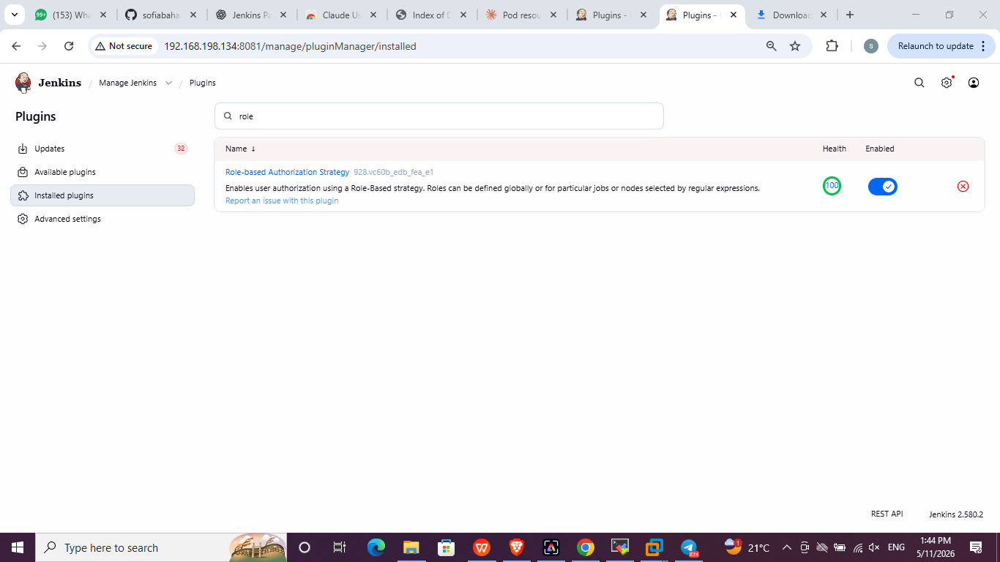
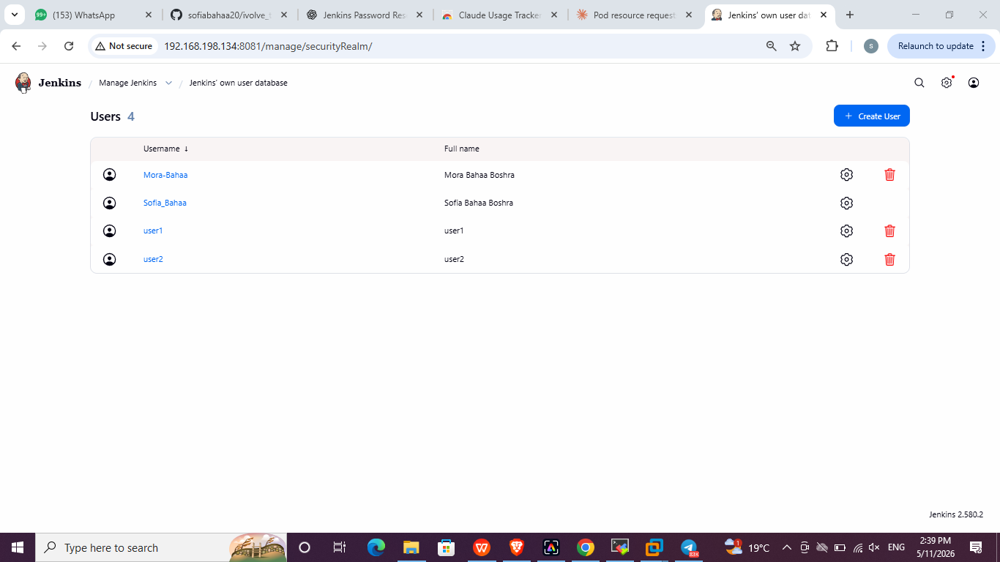
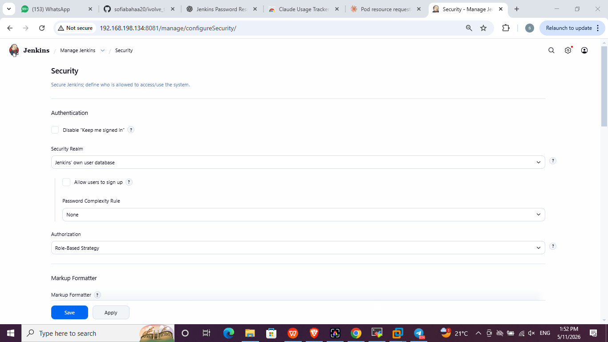
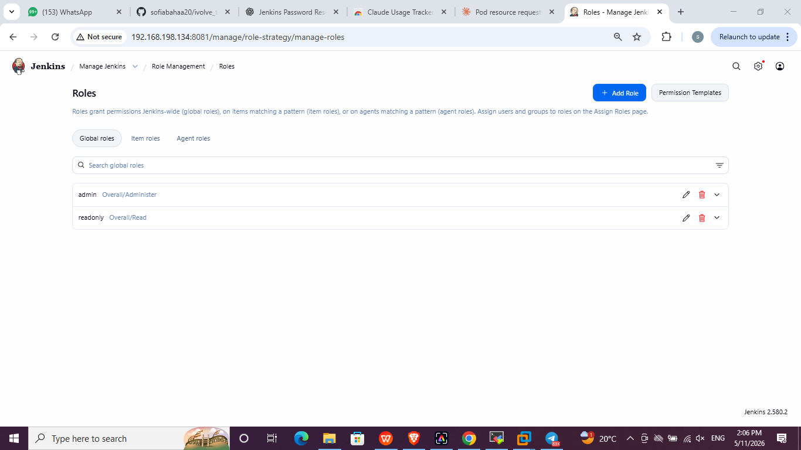
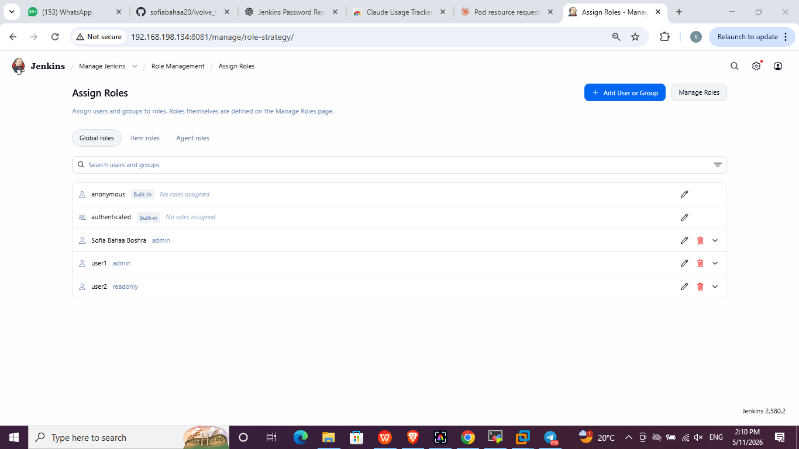

# Lab 20: Role-based Authorization in Jenkins

## Objective
- Create `user1` and `user2` in Jenkins
- Assign the **admin** role to `user1` and a **read-only** role to `user2`

## Steps

### 1. Install the plugin
**Manage Jenkins → Plugins → Available plugins** → install **Role-based Authorization Strategy**.

### 2. Create the users
**Manage Jenkins → Users → Create User** → create `user1` and `user2`.

### 3. Enable the Role-Based Strategy
**Manage Jenkins → Security → Authorization → Role-Based Strategy** → Save.
The Security Realm stays on *Jenkins' own user database*.

### 4. Define the global roles
**Manage Jenkins → Manage and Assign Roles → Manage Roles**

| Role | Permission |
|---|---|
| `admin` | Overall / Administer |
| `readonly` | Overall / Read |

### 5. Assign the roles
**Manage and Assign Roles → Assign Roles**

| User | Role |
|---|---|
| Sofia Bahaa (original admin) | admin |
| `user1` | admin |
| `user2` | readonly |

The original admin was assigned `admin` first so it would not be locked out when the strategy was enabled.

### 6. Validate
Logged in from a private window with each user:

- `user1`: sees **Manage Jenkins**, **New Item** and everything else.
- `user2`: sees the dashboard only; **Manage Jenkins** and **New Item** are not available.

