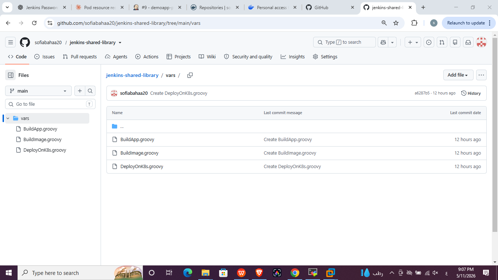
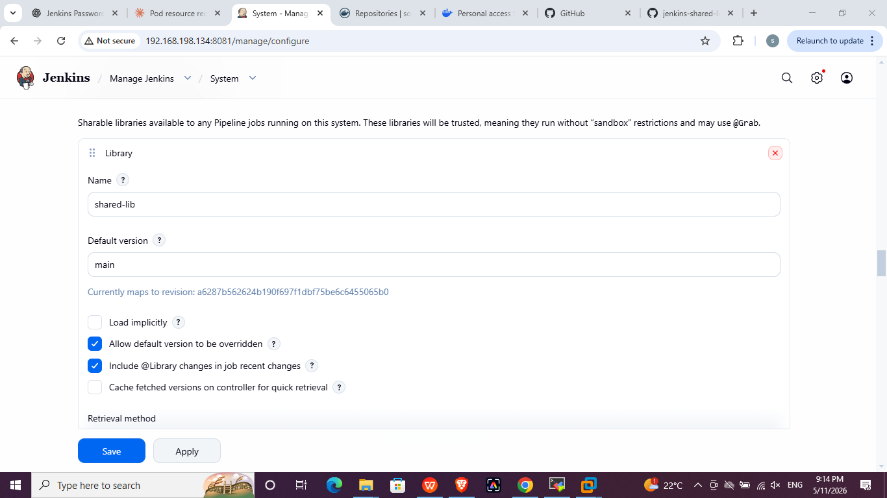
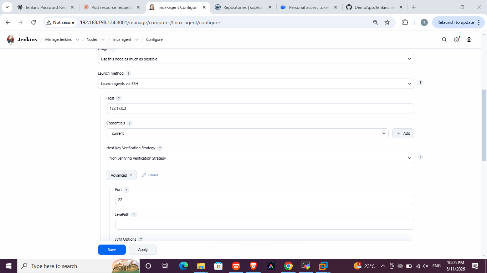
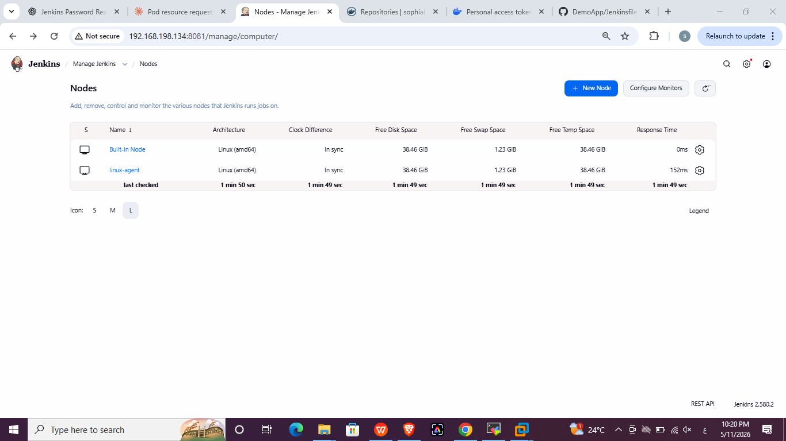
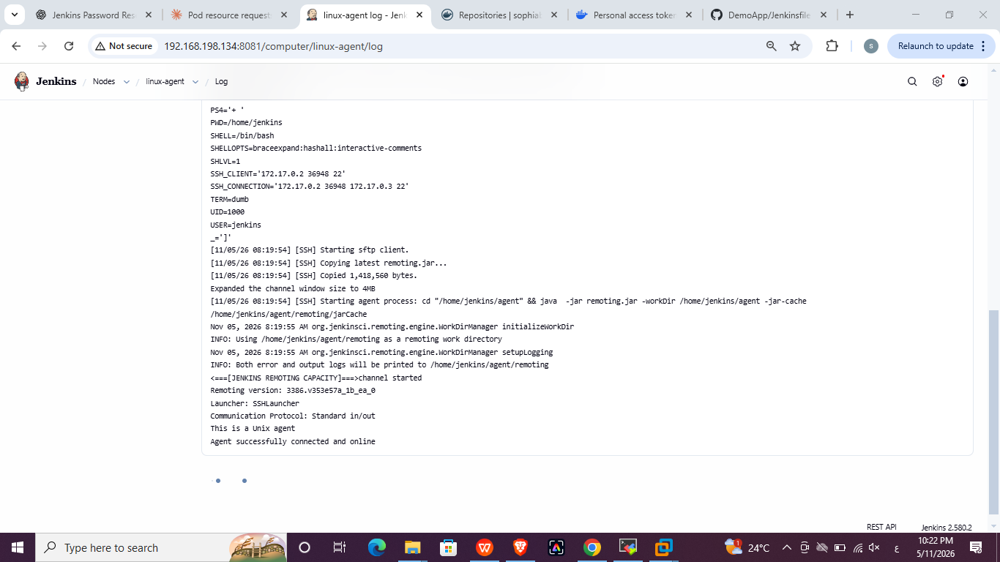

# Lab 22: CI/CD Pipeline Implementation with Jenkins Agents and Shared Libraries

## Objective
- Use the Dockerfile from https://github.com/Ibrahim-Adel15/DemoApp.git
- Create three shared libraries:
  1. `BuildApp` (unit test, build app)
  2. `BuildImage` (build image, scan image, push image, delete image locally)
  3. `DeployOnK8s` (edit deployment file, deploy to cluster)
- Update the pipeline to use them
- Configure a Jenkins agent to run the pipeline

## Structure
```
Lab22/
├── Jenkinsfile
├── shared-library/vars/     BuildApp.groovy, BuildImage.groovy, DeployOnK8s.groovy
├── agent-setup/             Dockerfile + run-agent.sh
├── k8s/                     deployment.yaml + service.yaml
├── screenshots/
└── README.md
```

Related repositories:
- Application + pipeline: https://github.com/sofiabahaa20/DemoApp
- Shared library: https://github.com/sofiabahaa20/jenkins-shared-library

## Part 1: Shared library

### Library repository
The `vars/` folder contains one file per function; the file name is the function name.

| Function | What it does |
|---|---|
| `BuildApp()` | `mvn test`, then `mvn clean package -DskipTests` |
| `BuildImage(image, tag, credentialsId)` | `docker build`, Trivy scan, `docker login` + `docker push`, `docker rmi` |
| `DeployOnK8s(image, tag, server, tokenId)` | `sed` updates the image in `deployment.yaml`, `kubectl apply`, `rollout status` |



### Register it in Jenkins
Manage Jenkins -> System -> Global Trusted Pipeline Libraries:

| Field | Value |
|---|---|
| Name | `shared-lib` |
| Default version | `main` |
| Retrieval method | Modern SCM -> Git |
| Project repository | `https://github.com/sofiabahaa20/jenkins-shared-library.git` |



### Use it in the Jenkinsfile
`@Library('shared-lib') _` is the first line, and each stage calls one function.



## Part 2: Jenkins agent
The agent is a Docker container on the RHEL VM (SSH agent image with Java, Maven, Docker CLI and kubectl). It shares the host Docker socket. See `agent-setup/`.

1. Generate an SSH key pair on the host (PEM format) and run `agent-setup/run-agent.sh`.
2. Add a credential: Manage Jenkins -> Credentials -> *SSH Username with private key*, ID `agent-ssh-key`, username `jenkins`.
3. Create the node: Manage Jenkins -> Nodes -> New Node -> Permanent Agent.

| Field | Value |
|---|---|
| Name | `linux-agent` |
| Executors | 1 |
| Remote root directory | `/home/jenkins/agent` |
| Labels | `agent-1` |
| Launch method | Launch agents via SSH |
| Host / Port | internal IP of the agent container / `22` |
| Credentials | `jenkins` (`agent-ssh-key`) |
| Host Key Verification | Non verifying |




4. The pipeline runs on it with `agent { label 'agent-1' }`.


## Kubernetes manifests
`k8s/deployment.yaml` is applied by the pipeline. `k8s/service.yaml` is applied once manually, because the `jenkinssa` Role from Lab 19 only covers deployments. The Deployment uses `strategy: Recreate` because the namespace quota allows only 3 pods.

## Issues faced and fixes
- **Agent authentication failed** with `PEM problem: it is of unknown type`: the private key was converted to PEM format (`ssh-keygen -p -m PEM`) and the credential was updated.
- **Node still pointed to the VM address** instead of the agent container: the Host was changed to the container IP with port `22`.
