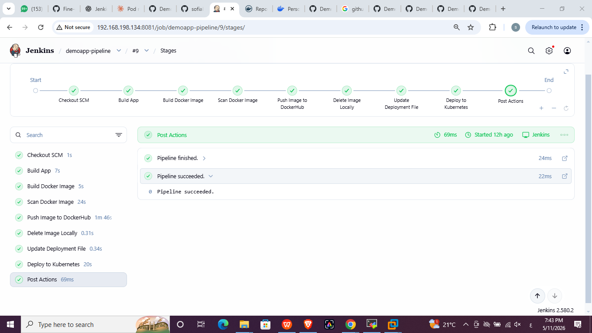
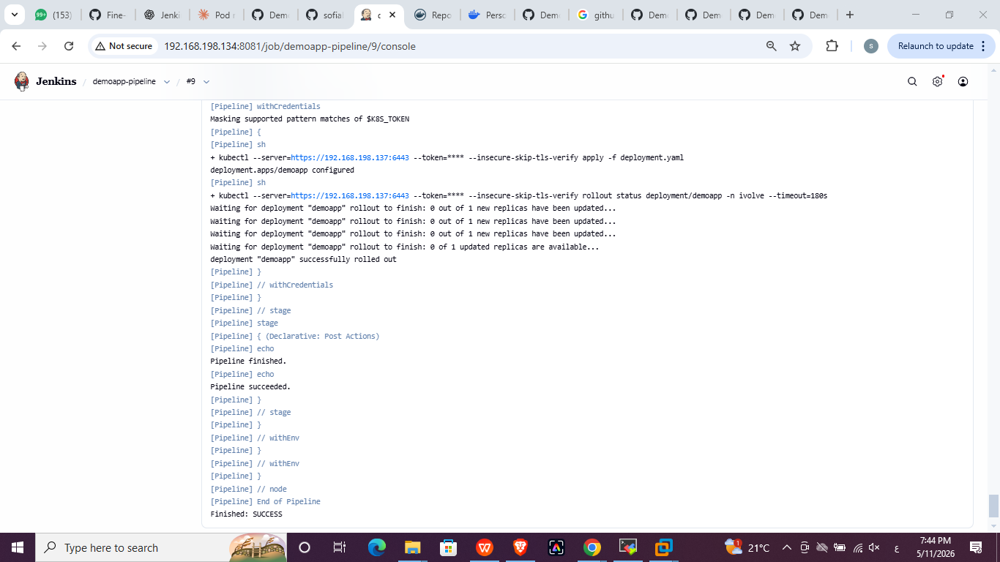
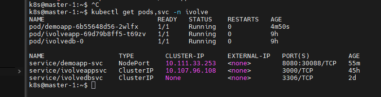
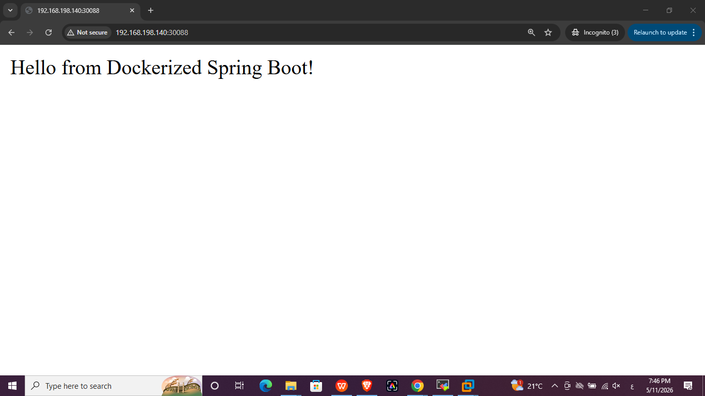

# Lab 21: Jenkins Pipeline for Application Deployment

## Objective
Build a Jenkins pipeline for the `DemoApp` Spring Boot application (source: `Ibrahim-Adel15/DemoApp`) that automates:

1. Build app
2. Build Docker image
3. Scan Docker image
4. Push image to DockerHub
5. Delete image locally
6. Update image in the deployment file
7. Deploy to the Kubernetes cluster

with post actions for `always`, `success` and `failure`.

## Environment
- Jenkins runs as a Docker container (image with `docker`, `kubectl` and Maven installed), exposed on port `8081`.
- The Docker socket of the host is mounted into the container so the pipeline can build, scan and push images.
- Kubernetes cluster: kubeadm (1 master, 1 worker), namespace `ivolve`.
- Source repository: https://github.com/sofiabahaa20/DemoApp (contains `src`, `pom.xml`, `Dockerfile`, `deployment.yaml`, `Jenkinsfile`).

## Credentials (Manage Jenkins → Credentials)
| ID | Type | Used for |
|---|---|---|
| `dockerhub-creds` | Username with password (DockerHub access token) | Pushing the image |
| `k8s-token` | Secret text (token of the `jenkinssa` Service Account from Lab 19) | Deploying to the cluster |

The `jenkinssa` token is limited by the `ivolvedeployrole` Role, so Jenkins can only manage Deployments in the `ivolve` namespace.

## Dockerfile
```dockerfile
FROM eclipse-temurin:17-jre-alpine
WORKDIR /app
COPY target/demo-0.0.1-SNAPSHOT.jar .
EXPOSE 8080
CMD ["java", "-jar", "demo-0.0.1-SNAPSHOT.jar"]
```
A JRE-only Alpine image keeps the image small and the scan fast.

## Pipeline stages (`Jenkinsfile`)
| Stage | What it does |
|---|---|
| Build App | `mvn -B clean package -DskipTests` |
| Build Docker Image | `docker build -t <user>/demoapp:<BUILD_NUMBER> .` |
| Scan Docker Image | Trivy scan (HIGH and CRITICAL) |
| Push Image to DockerHub | `docker login` then `docker push` |
| Delete Image Locally | `docker rmi` |
| Update Deployment File | `sed` replaces the image line in `deployment.yaml` with the new tag |
| Deploy to Kubernetes | `kubectl apply -f deployment.yaml` then `rollout status` |

Post actions: `always` (pipeline finished), `success` (pipeline succeeded), `failure` (pipeline failed).

## Kubernetes manifest
- Deployment `demoapp` in namespace `ivolve`, 1 replica, `nodeSelector: project=ivolve` and a toleration for the `workload` taint of the worker node.
- Strategy `Recreate`: the namespace has a ResourceQuota of 3 pods, so a rolling update could not create an extra pod.
- The Service `demoapp-svc` (NodePort `30088`) was created once manually, because the `jenkinssa` Role only allows Deployments.

## Result

### Pipeline stages (build #9, all green)


### Console output: `Finished: SUCCESS`


### Pods and services in the cluster
```bash
kubectl get pods,svc -n ivolve
```


### Application in the browser (`http://<worker-ip>:30088`)


## Issues faced and fixes
| Issue | Fix |
|---|---|
| Trivy scan timed out (`context deadline exceeded`) on the large `maven:sapmachine` image | Switched to `eclipse-temurin:17-jre-alpine` |
| Trivy DB download failed (404 from `mirror.gcr.io`) | Used `ghcr.io` as the DB repository and a cache volume |
| `jenkinssa` forbidden to read Services | Service created manually; Role updated with `watch` for `rollout status` |
| Rollout blocked by the 3-pod ResourceQuota | Set `strategy: Recreate` |
