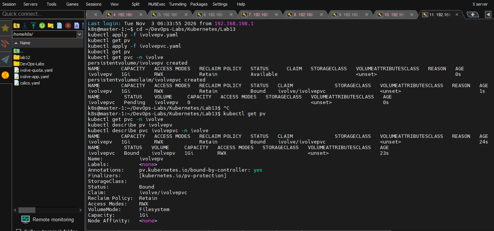
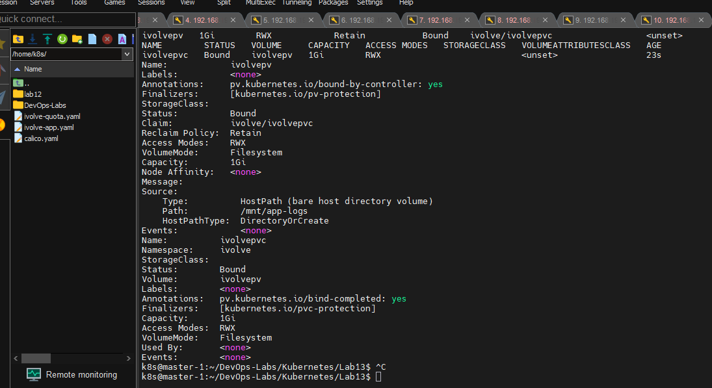
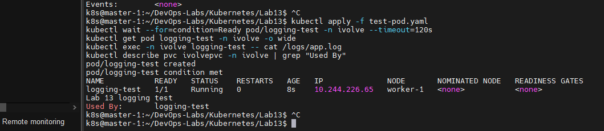
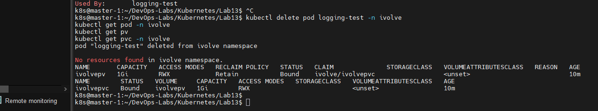
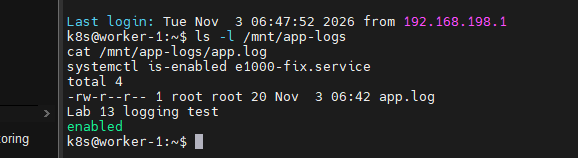

# Lab 13: Persistent Storage Setup for Application Logging

## Objective
Pods are ephemeral: when a pod is deleted, everything written to its own filesystem is lost.
This lab creates persistent storage for application logs using a **PersistentVolume (PV)** and a **PersistentVolumeClaim (PVC)**, backed by a `hostPath` directory on the node.

## Requirements
| Resource | Setting |
|---|---|
| PV name | `ivolvepv` (Kubernetes names must be lowercase) |
| Size | 1Gi |
| Storage type | `hostPath` |
| Path | `/mnt/app-logs` on the node filesystem |
| Access mode | `ReadWriteMany` (RWX) |
| Reclaim policy | `Retain` |
| PVC name | `ivolvepvc` (namespace `ivolve`), requests 1Gi, RWX |
| StorageClass | none (`storageClassName: ""`) |

## Environment
- Kubernetes v1.35.9 cluster built with kubeadm (containerd, Calico)
- `master-1` (control plane) and `worker-1` (tainted `workload=ivolveApp:NoSchedule`, labeled `project=ivolve`)

## Files
- `ivolvepv.yaml`: PersistentVolume
- `ivolvepvc.yaml`: PersistentVolumeClaim
- `test-pod.yaml`: busybox pod used to prove the storage works

## Steps

### 1. Create the PV and the PVC
```bash
kubectl apply -f ivolvepv.yaml
kubectl get pv
kubectl apply -f ivolvepvc.yaml
kubectl get pv
kubectl get pvc -n ivolve
```
The PV is `Available` first, then becomes `Bound` to `ivolve/ivolvepvc` once the claim is created.



### 2. Verify the details
```bash
kubectl describe pv ivolvepv
kubectl describe pvc ivolvepvc -n ivolve
```
Confirmed: `Reclaim Policy: Retain`, `Access Modes: RWX`, `Capacity: 1Gi`, `Path: /mnt/app-logs`, `HostPathType: DirectoryOrCreate`, empty `StorageClass`, and the PVC is `Bound` to `ivolvepv`.



### 3. Test the storage with a pod
The pod mounts the PVC at `/logs` and writes to `/logs/app.log`.
Because `worker-1` has a taint, the pod uses a `toleration` for `workload=ivolveApp:NoSchedule` and a `nodeSelector` (`project: ivolve`) so it runs on the worker.

```bash
kubectl apply -f test-pod.yaml
kubectl wait --for=condition=Ready pod/logging-test -n ivolve --timeout=120s
kubectl get pod logging-test -n ivolve -o wide
kubectl exec -n ivolve logging-test -- cat /logs/app.log
kubectl describe pvc ivolvepvc -n ivolve | grep "Used By"
```
The pod runs on `worker-1`, the log line is readable, and the PVC shows `Used By: logging-test`.



### 4. Prove persistence: delete the pod
```bash
kubectl delete pod logging-test -n ivolve
kubectl get pod -n ivolve
kubectl get pv
kubectl get pvc -n ivolve
```
The pod is gone, but the PV and the PVC are still `Bound`.



### 5. Check the file on the worker node
```bash
ssh k8s@192.168.198.140
ls -l /mnt/app-logs
cat /mnt/app-logs/app.log
```
The directory `/mnt/app-logs` was created automatically by `DirectoryOrCreate`, and `app.log` still contains `Lab 13 logging test` after the pod was deleted.



## Notes
- **hostPath is node-local.** Each node has its own `/mnt/app-logs`. Pods on different nodes would not share the same files, so the test pod is pinned to `worker-1`. In production, NFS or cloud storage is used instead.
- **Retain** keeps the PV and its data when the PVC is deleted; the PV must be cleaned up manually.
- `storageClassName: ""` explicitly disables dynamic provisioning so the claim binds to the manually created PV.
- `DirectoryOrCreate` removes the need to run `mkdir` manually on the node.
