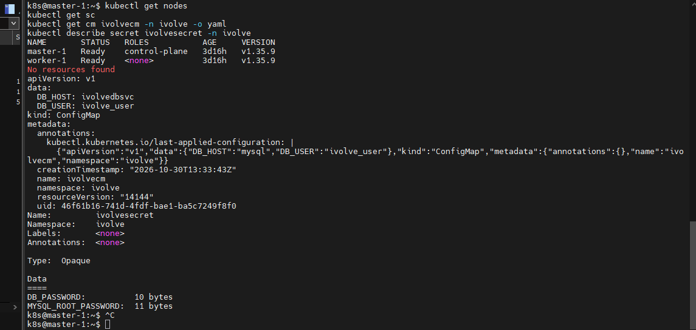
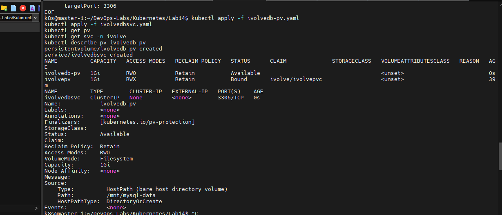
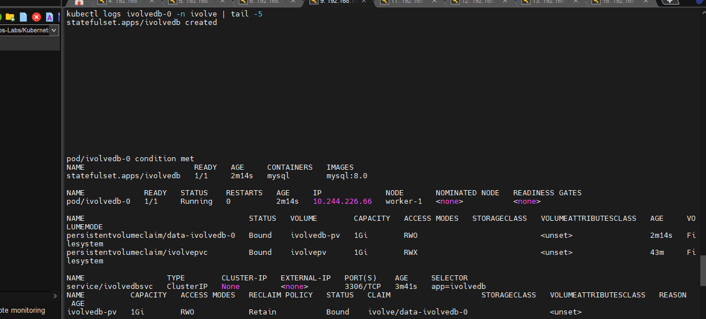
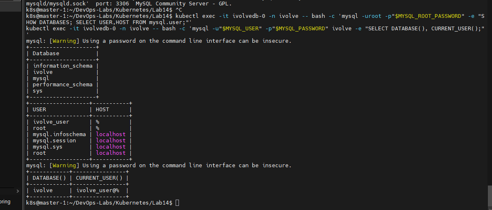
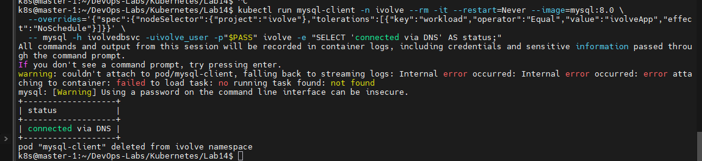
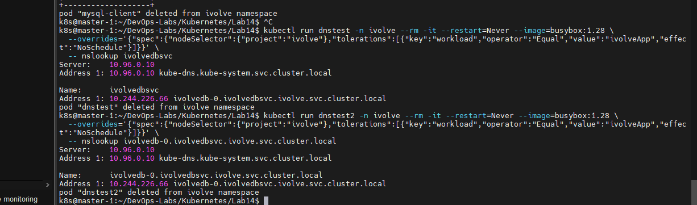
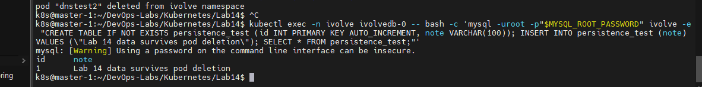
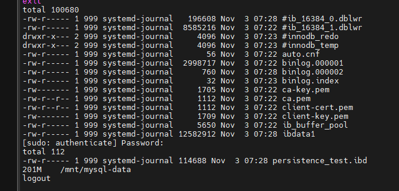

# Lab 14: StatefulSet with Headless Service

## Objective
Run a MySQL database inside Kubernetes the right way: as a **StatefulSet** with stable pod identity, its own persistent storage, and a **headless Service** that gives the pod a stable DNS name.

## Why StatefulSet (and not Deployment)?
| | Deployment | StatefulSet |
|---|---|---|
| Pod name | random | stable and ordered (`ivolvedb-0`) |
| When a pod is deleted | comes back with a new name | comes back with the **same name** |
| Storage | shared or not tied to a pod | **one PVC per pod**, re-attached to the same pod |
| Typical use | stateless apps | databases and other stateful systems |

A **headless Service** (`clusterIP: None`) does not load-balance behind a single IP. It creates a DNS record for each pod, so clients can reach `ivolvedb-0` directly by name.

## Requirements
- StatefulSet `ivolvedb` in namespace `ivolve`, 1 replica, running MySQL
- Environment variables consumed from the existing ConfigMap and Secret
- `nodeSelector`: `project=ivolve`
- Toleration: `workload=ivolveApp` with effect `NoSchedule`
- PVC template mounting `/var/lib/mysql`
- Headless Service `ivolvedbsvc` targeting the StatefulSet pod
- Verify the database with a MySQL client and verify pod DNS resolution

(Kubernetes names must be lowercase, so `ivolveDB` becomes `ivolvedb` and `ivolveDBSvc` becomes `ivolvedbsvc`.)

## Environment
- Kubernetes v1.35.9 (kubeadm, containerd, Calico): `master-1` and `worker-1`
- `worker-1` is labeled `project=ivolve` and tainted `workload=ivolveApp:NoSchedule`
- No StorageClass exists in the cluster, so the PV is created manually

## Files
- `ivolvedb-pv.yaml`: PersistentVolume (hostPath `/mnt/mysql-data`, 1Gi, RWO, Retain)
- `ivolvedbsvc.yaml`: headless Service
- `ivolvedb-statefulset.yaml`: StatefulSet with the PVC template

## Steps

### 1. Check the prerequisites
```bash
kubectl get nodes
kubectl get pods,pvc -n ivolve
kubectl get sc
kubectl get cm ivolvecm -n ivolve -o yaml
kubectl describe secret ivolvesecret -n ivolve
```
- ConfigMap `ivolvecm` keys: `DB_HOST`, `DB_USER`
- Secret `ivolvesecret` keys: `DB_PASSWORD`, `MYSQL_ROOT_PASSWORD`
- No StorageClass exists, so no dynamic provisioning.

The MySQL image expects `MYSQL_ROOT_PASSWORD`, `MYSQL_DATABASE`, `MYSQL_USER` and `MYSQL_PASSWORD`. The ConfigMap and Secret use different key names, so the StatefulSet loads them with `envFrom` and maps `MYSQL_USER` and `MYSQL_PASSWORD` explicitly.



### 2. Create the PV and the headless Service
```bash
kubectl apply -f ivolvedb-pv.yaml
kubectl apply -f ivolvedbsvc.yaml
kubectl get pv
kubectl get svc -n ivolve
kubectl describe pv ivolvedb-pv
```
- `ivolvedb-pv` is `Available` (RWO, Retain, no StorageClass, hostPath `/mnt/mysql-data`).
- `ivolvedbsvc` has `CLUSTER-IP: None`, which makes it headless.



### 3. Create the StatefulSet
```bash
kubectl apply -f ivolvedb-statefulset.yaml
kubectl wait --for=condition=Ready pod/ivolvedb-0 -n ivolve --timeout=300s
kubectl get statefulset,pods,pvc,svc -n ivolve -o wide
kubectl get pv
kubectl logs ivolvedb-0 -n ivolve | tail -5
```
- Pod `ivolvedb-0` is `Running` on `worker-1` (nodeSelector and toleration work).
- The PVC `data-ivolvedb-0` was created automatically from the `volumeClaimTemplates` and is `Bound` to `ivolvedb-pv`.
- The logs end with `ready for connections` on port 3306.



### 4. Verify the database from inside the pod
```bash
kubectl exec -it ivolvedb-0 -n ivolve -- bash -c 'mysql -uroot -p"$MYSQL_ROOT_PASSWORD" -e "SHOW DATABASES; SELECT USER,HOST FROM mysql.user;"'
kubectl exec -it ivolvedb-0 -n ivolve -- bash -c 'mysql -u"$MYSQL_USER" -p"$MYSQL_PASSWORD" ivolve -e "SELECT DATABASE(), CURRENT_USER();"'
```
The `ivolve` database and the `ivolve_user` user exist, and logging in with `ivolve_user` works. This proves the ConfigMap/Secret mapping is correct.



### 5. Connect with a MySQL client through the Service DNS name
```bash
PASS=$(kubectl get secret ivolvesecret -n ivolve -o jsonpath='{.data.DB_PASSWORD}' | base64 -d)
kubectl run mysql-client -n ivolve --rm -it --restart=Never --image=mysql:8.0 \
  --overrides='{"spec":{"nodeSelector":{"project":"ivolve"},"tolerations":[{"key":"workload","operator":"Equal","value":"ivolveApp","effect":"NoSchedule"}]}}' \
  -- mysql -h ivolvedbsvc -uivolve_user -p"$PASS" ivolve -e "SELECT 'connected via DNS' AS status;"
```
The temporary client pod needs the same nodeSelector and toleration, because both nodes are tainted.
The password is read from the Secret instead of being typed in the command.



### 6. Verify DNS resolution
```bash
kubectl run dnstest -n ivolve --rm -it --restart=Never --image=busybox:1.28 \
  --overrides='{"spec":{"nodeSelector":{"project":"ivolve"},"tolerations":[{"key":"workload","operator":"Equal","value":"ivolveApp","effect":"NoSchedule"}]}}' \
  -- nslookup ivolvedbsvc

kubectl run dnstest2 -n ivolve --rm -it --restart=Never --image=busybox:1.28 \
  --overrides='{"spec":{"nodeSelector":{"project":"ivolve"},"tolerations":[{"key":"workload","operator":"Equal","value":"ivolveApp","effect":"NoSchedule"}]}}' \
  -- nslookup ivolvedb-0.ivolvedbsvc.ivolve.svc.cluster.local
```
Both names resolve directly to the **pod IP** (`10.244.226.66`), not to a Service IP. That is the behavior of a headless Service.



### 7. Persistence test: write data and look at the node
```bash
kubectl exec -n ivolve ivolvedb-0 -- bash -c 'mysql -uroot -p"$MYSQL_ROOT_PASSWORD" ivolve -e "CREATE TABLE IF NOT EXISTS persistence_test (id INT PRIMARY KEY AUTO_INCREMENT, note VARCHAR(100)); INSERT INTO persistence_test (note) VALUES (\"Lab 14 data survives pod deletion\"); SELECT * FROM persistence_test;"'
```



On `worker-1`:
```bash
ls -l /mnt/mysql-data | head -15
sudo ls -l /mnt/mysql-data/ivolve
sudo du -sh /mnt/mysql-data
```
The MySQL data files (`ibdata1`, `binlog.*`, `ivolve/persistence_test.ibd`) are on the node, owned by UID 999 (the `mysql` user inside the container). This proves `/var/lib/mysql` is backed by `/mnt/mysql-data`.



### 8. Persistence test: delete the pod
`DB_HOST` in the ConfigMap was `mysql`, but the real Service is `ivolvedbsvc`, so it was updated first. The new pod picks up the new value.
```bash
kubectl patch configmap ivolvecm -n ivolve --type merge -p '{"data":{"DB_HOST":"ivolvedbsvc"}}'
kubectl delete pod ivolvedb-0 -n ivolve
kubectl wait --for=condition=Ready pod/ivolvedb-0 -n ivolve --timeout=300s
kubectl get pods,pvc -n ivolve -o wide
kubectl exec -n ivolve ivolvedb-0 -- bash -c 'mysql -uroot -p"$MYSQL_ROOT_PASSWORD" ivolve -e "SELECT * FROM persistence_test;"'
kubectl exec -n ivolve ivolvedb-0 -- printenv DB_HOST
kubectl logs ivolvedb-0 -n ivolve | head -4
```
- The StatefulSet recreated the pod with the **same name** `ivolvedb-0`. The IP changed (`10.244.226.66` to `10.244.226.70`), but the DNS name stayed the same.
- The PVC `data-ivolvedb-0` kept its age and stayed `Bound`.
- The row `Lab 14 data survives pod deletion` is still there.
- The startup logs contain no `Initializing database files`, so MySQL found the existing data.
- `DB_HOST` inside the new pod is `ivolvedbsvc`.


## Notes
- **hostPath is node-local**, which is why the pod is pinned to `worker-1`. In production, network or cloud storage with a StorageClass is used instead.
- **`storageClassName: ""`** in both the PV and the PVC template disables dynamic provisioning so the claim binds to the manually created PV.
- **RWO** is used for the database volume because a single pod writes to the MySQL data directory.
- **`Retain`** keeps the data if the PVC is deleted.
- `DirectoryOrCreate` creates `/mnt/mysql-data` automatically, and the official MySQL image fixes the directory ownership when it starts.
- Passwords come from the Secret and are never written in the manifests or in this README.
