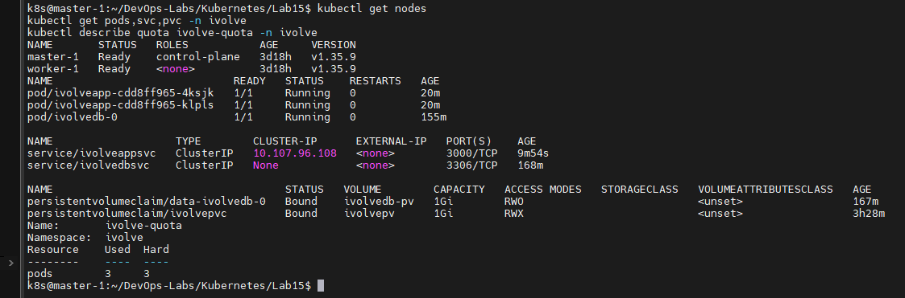
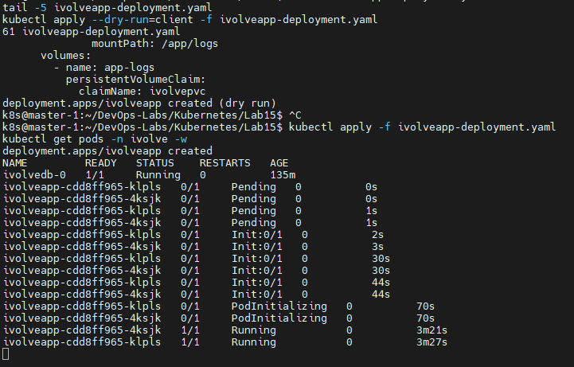
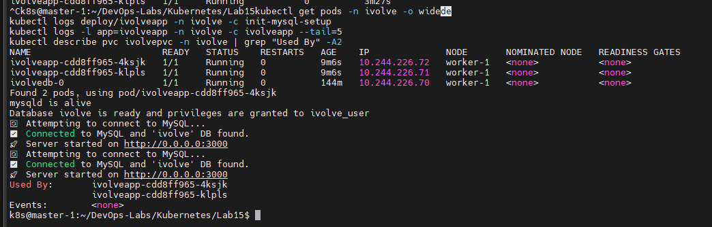
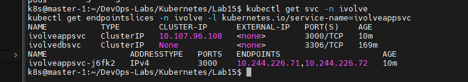
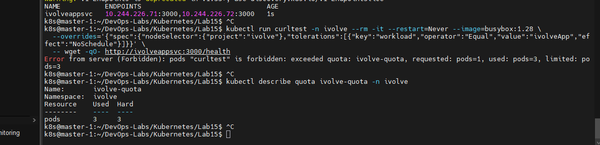
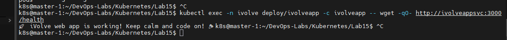
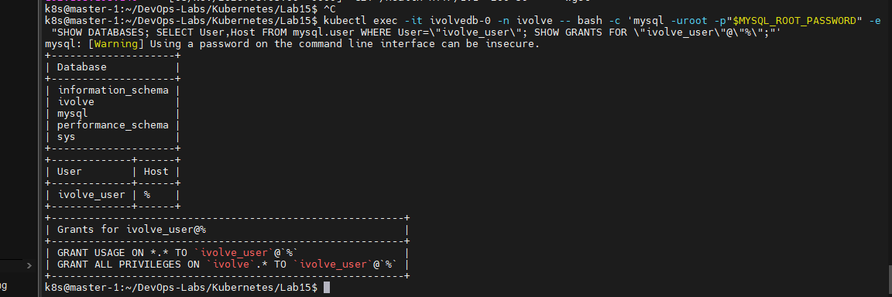
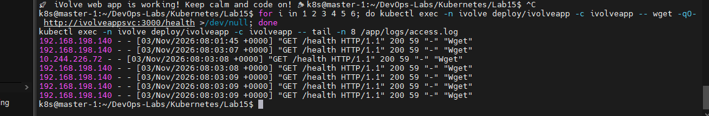
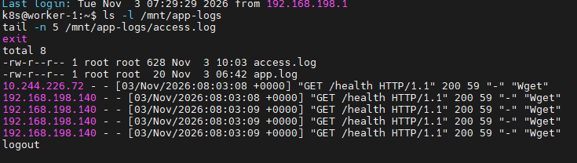

# Lab 15: Node.js Application Deployment with a ClusterIP Service

## Objective
Deploy the custom Node.js application (the Docker image built in Lab 8) on Kubernetes with two replicas. The pods read their database settings from the existing ConfigMap and Secret, write their logs to the persistent volume from Lab 13, and talk to the MySQL StatefulSet from Lab 14. A ClusterIP Service spreads the traffic across the pods.

## How the pieces fit together
| Component | Role |
|---|---|
| Deployment `ivolveapp` (2 replicas) | Runs the stateless Node.js app. A failed pod is replaced automatically. |
| Init container (`mysql:8.0` client) | Runs **before** the app. Waits for MySQL, creates the `ivolve` database and grants the app user its privileges. |
| ConfigMap `ivolvecm` + Secret `ivolvesecret` | Provide `DB_HOST`, `DB_USER`, `DB_PASSWORD` (and `MYSQL_ROOT_PASSWORD` for the init container). |
| PVC `ivolvepvc` (Lab 13) | Mounted at `/app/logs`, so the access log survives pod deletion and is shared by both replicas (RWX). |
| `nodeSelector` + toleration | Schedule the pods on `worker-1` (`project=ivolve`, taint `workload=ivolveApp:NoSchedule`). |
| Service `ivolveappsvc` (ClusterIP) | Stable internal IP and DNS name that load-balances across the app pods. |

## Requirements
- Deployment `ivolveapp` in namespace `ivolve`, 2 replicas
- Custom image from Docker Hub (Lab 8): `sophiabahaaboshra/ivolve-app:latest`
- Environment variables from the existing ConfigMap and Secret
- `nodeSelector: project=ivolve` and toleration `workload=ivolveApp:NoSchedule`
- Use the PersistentVolume from Lab 13
- Init container (MySQL client image) that creates the `ivolve` database and grants the application user privileges, using the ConfigMap and Secret for its connection parameters
- ClusterIP Service in front of the pods
- Verify the database and the user's privileges manually, and check the application logs

(Kubernetes names must be lowercase: `ivolveApp` becomes `ivolveapp` and `ivolvaAppSvc` becomes `ivolveappsvc`.)

## What the application expects
Taken from the Lab 8 project (`Dockerfile` and `server.js`):
- Base image `node:18-alpine`, listens on port **3000** on `0.0.0.0`
- Reads `DB_HOST`, `DB_USER`, `DB_PASSWORD`. These are the same key names as in the ConfigMap and Secret, so `envFrom` is enough and no mapping is needed.
- Connects to MySQL and retries every 5 seconds until the `ivolve` database exists
- Writes its access log to `/app/logs/access.log`
- Exposes `/health` (runs `SELECT 1` on the database) and `/ready`

## Files
- `ivolveapp-deployment.yaml`: Deployment with the init container, env, volume and scheduling rules
- `ivolveappsvc.yaml`: ClusterIP Service

## Environment
- Kubernetes v1.35.9 (kubeadm): `master-1` and `worker-1`
- Namespace `ivolve` already contains `ivolvedb-0` (Lab 14), the PVC `ivolvepvc` (Lab 13), `ivolvecm`, `ivolvesecret`
- `DB_HOST` in `ivolvecm` was updated to `ivolvedbsvc` in Lab 14 to match the real headless Service
- The namespace has a ResourceQuota `ivolve-quota` limiting it to **3 pods**: 1 database pod + 2 application pods

## Steps

### 1. Check the prerequisites
```bash
kubectl get nodes
kubectl get pods,svc,pvc -n ivolve
kubectl describe quota ivolve-quota -n ivolve
```
Both nodes are `Ready`, `ivolvedb-0` is running and `ivolvepvc` is `Bound`.



### 2. Create the Deployment
```bash
kubectl apply -f ivolveapp-deployment.yaml
kubectl get pods -n ivolve -w
```
Each pod goes through `Init:0/1`, then `PodInitializing`, then `Running 1/1`. The first start takes a few minutes because the image is pulled from Docker Hub.

Key parts of the manifest:
- `initContainers`: a `mysql:8.0` container that waits with `mysqladmin ping`, then runs `CREATE DATABASE IF NOT EXISTS ivolve`, `CREATE USER IF NOT EXISTS ...` and `GRANT ALL PRIVILEGES ON ivolve.* ...`. Every statement is idempotent, so it is safe when the database and the user already exist (Lab 14 created them). The root password is passed with `MYSQL_PWD` instead of the command line.
- `envFrom` with `configMapRef: ivolvecm` and `secretRef: ivolvesecret` in both the init container and the application container.
- `volumes` / `volumeMounts`: PVC `ivolvepvc` mounted at `/app/logs`.
- `nodeSelector: project=ivolve` and the `workload=ivolveApp:NoSchedule` toleration.



### 3. Verify the pods, the init container and the logs
```bash
kubectl get pods -n ivolve -o wide
kubectl logs deploy/ivolveapp -n ivolve -c init-mysql-setup
kubectl logs -l app=ivolveapp -n ivolve -c ivolveapp --tail=5
kubectl describe pvc ivolvepvc -n ivolve | grep "Used By" -A2
```
- Both application pods run on `worker-1`.
- The init container printed `Database ivolve is ready and privileges are granted to ivolve_user`.
- Both pods logged `Connected to MySQL and 'ivolve' DB found` and `Server started on http://0.0.0.0:3000`.
- `ivolvepvc` is now used by both pods.



### 4. Create the ClusterIP Service
```bash
kubectl apply -f ivolveappsvc.yaml
kubectl get svc -n ivolve
kubectl get endpointslices -n ivolve -l kubernetes.io/service-name=ivolveappsvc
```
`ivolveappsvc` gets a real cluster IP on port 3000 (unlike the headless `ivolvedbsvc`, which has `None`). Its endpoints are the IPs of the two application pods, which is how the traffic is spread across them.



### 5. Test the Service from inside the cluster
A temporary test pod is rejected because of the namespace quota (3 pods are already running):
```bash
kubectl run curltest -n ivolve --rm -it --restart=Never --image=busybox:1.28 ... -- wget -qO- http://ivolveappsvc:3000/health
# Error from server (Forbidden): exceeded quota: ivolve-quota, requested: pods=1, used: pods=3, limited: pods=3
kubectl describe quota ivolve-quota -n ivolve
```



So the test runs from inside an existing application pod instead:
```bash
kubectl exec -n ivolve deploy/ivolveapp -c ivolveapp -- wget -qO- http://ivolveappsvc:3000/health
```
The response is `iVolve web app is working!`. This confirms that the Service name resolves, the request reaches an application pod, and that pod can query MySQL (`/health` runs `SELECT 1`).



### 6. Verify MySQL manually
```bash
kubectl exec -it ivolvedb-0 -n ivolve -- bash -c 'mysql -uroot -p"$MYSQL_ROOT_PASSWORD" -e "SHOW DATABASES; SELECT User,Host FROM mysql.user WHERE User=\"ivolve_user\"; SHOW GRANTS FOR \"ivolve_user\"@\"%\";"'
```
- The `ivolve` database exists.
- The user `ivolve_user` exists for host `%`.
- The grants include `GRANT ALL PRIVILEGES ON ivolve.* TO ivolve_user@%`. The privileges are limited to the `ivolve` database and are not global.



### 7. Check the access log
```bash
for i in 1 2 3 4 5 6; do kubectl exec -n ivolve deploy/ivolveapp -c ivolveapp -- wget -qO- http://ivolveappsvc:3000/health >/dev/null; done
kubectl exec -n ivolve deploy/ivolveapp -c ivolveapp -- tail -n 8 /app/logs/access.log
```
The requests sent through the Service appear in `/app/logs/access.log`.



### 8. Check the log file on the node
On `worker-1`:
```bash
ls -l /mnt/app-logs
tail -n 5 /mnt/app-logs/access.log
```
`access.log` is written by the application pods into `/mnt/app-logs` on the node. The `app.log` file created by the test pod in Lab 13 is still in the same directory, which confirms that the pods use the persistent volume from Lab 13.



## Notes
- **Init container**: Kubernetes starts the app container only after the init container finishes successfully. Because the application retries forever when the `ivolve` database is missing, the init container makes sure the database and privileges exist before the app starts.
- **Idempotent SQL** (`IF NOT EXISTS`) lets the init container run on every pod start without errors.
- **Quota**: `ivolve-quota` allows 3 pods. A rolling update needs an extra pod, so scale down or raise the quota temporarily before changing the image.
- **hostPath is node-local**: both replicas run on `worker-1`, so they share `/mnt/app-logs`. Replicas on different nodes would write to different directories.
- **Image tag**: `latest` is used here for simplicity. A fixed version tag is better in production because it makes rollbacks predictable.
- Passwords come from the Secret and are never written in the manifests or in this README.
