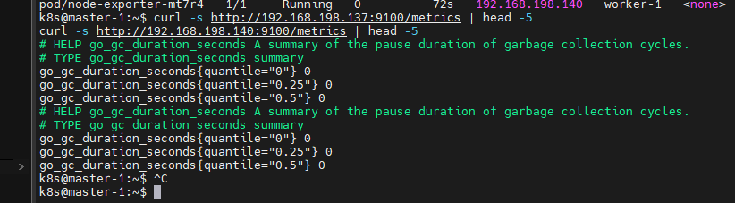
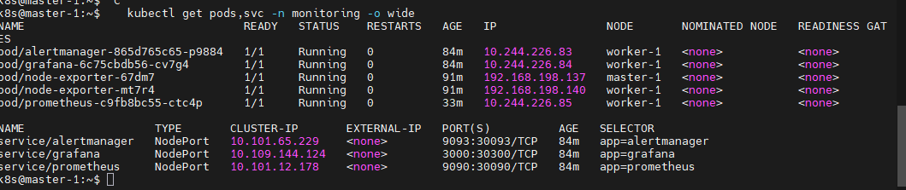
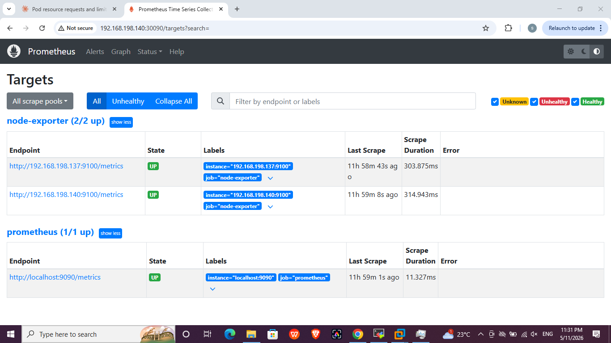
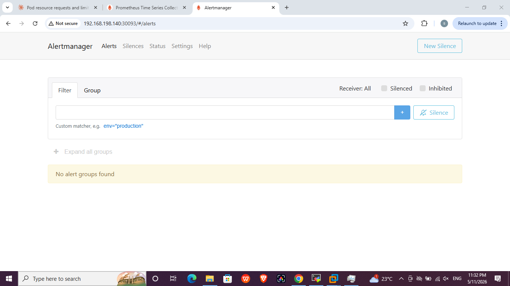
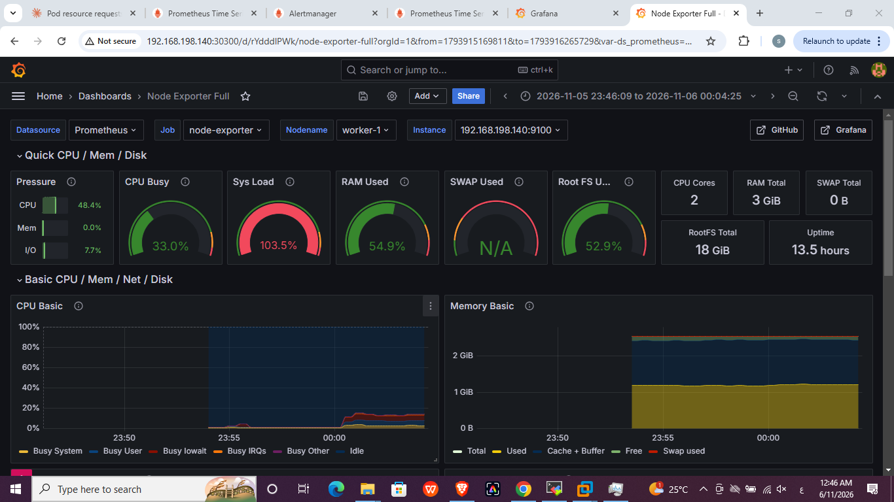

# Lab 18: Node-Wide Pod Management with DaemonSet

## Objective
- Create the `monitoring` namespace
- Deploy Prometheus, Alertmanager and Grafana in it
- Deploy a DaemonSet for Prometheus node-exporter
- Validate that a node-exporter pod runs on each node
- Confirm the metrics at `<node_IP>:9100/metrics`
- Configure Prometheus to collect data from node-exporter
- Configure a Grafana dashboard

Manifests in this folder: `node-exporter.yaml`, `monitoring.yaml`.

## Design notes
The cluster is small (2 nodes, about 2.5 GiB RAM each), so the stack is deployed with plain manifests, small resource requests and limits, and no persistent volumes (Prometheus keeps 2 days of data in an `emptyDir`). The worker node has a taint (`workload`), so the pods that run there carry a matching toleration.

## Steps

### 1. Namespace
```bash
kubectl create namespace monitoring
```

### 2. node-exporter DaemonSet
```bash
kubectl apply -f node-exporter.yaml
kubectl get ds,pods -n monitoring -o wide
```
`tolerations: operator: Exists` lets the DaemonSet schedule on the control-plane node (taint) and on the worker (taint), so there is one pod per node. It uses `hostNetwork` and `hostPort: 9100`.


### 3. Check the metrics
```bash
curl -s http://192.168.198.137:9100/metrics | head -5
curl -s http://192.168.198.140:9100/metrics | head -5
```


### 4. Prometheus, Alertmanager and Grafana
```bash
kubectl apply -f monitoring.yaml
kubectl get pods,svc -n monitoring -o wide
```
Services are exposed as NodePorts:

| Component | Port |
|---|---|
| Prometheus | 30090 |
| Alertmanager | 30093 |
| Grafana | 30300 |



### 5. Prometheus collects from node-exporter
The `prometheus-config` ConfigMap has a `node-exporter` job with both node IPs on port 9100, and points to Alertmanager. All targets are `UP` at `http://<node-ip>:30090/targets`.



Alertmanager UI: `http://<node-ip>:30093`



### 6. Grafana dashboard
The Prometheus data source is provisioned from the `grafana-datasource` ConfigMap. The dashboard **Node Exporter Full** (Grafana.com ID `1860`) was imported from Dashboards -> New -> Import, with the Prometheus data source.



## Issues faced and fixes
- **Dashboard showed `N/A` / `No data`:** the VM clocks were not in sync with the Windows host, so Grafana's "last 15 minutes" window did not overlap the stored samples. Prometheus was moved to the worker node (whose clock was close to the host) and the Grafana time range was widened.
- **Taints:** pods that run on the worker need a toleration for the `workload` taint, and pods on the control plane need a toleration for the control-plane taint.
