# Lab 9: Deploy a Kubernetes Cluster Using Kubeadm

## Objective

Build a two-node Kubernetes cluster with `kubeadm`:

- Install and configure **containerd** as the container runtime on all nodes.
- Install **kubeadm**, **kubelet**, and **kubectl** on the control plane and worker nodes.
- Configure **kubectl** to communicate with the cluster.
- Install the **Calico** CNI plugin for pod networking.
- Initialize the control plane with `kubeadm init`.
- Join the worker node with `kubeadm join`.
- Verify that all nodes are `Ready` and the cluster components are running.

## Environment

| Item | Value |
|---|---|
| Hypervisor | VMware Workstation |
| OS | Ubuntu Server 26.04.1 LTS |
| Control plane | `master-1`, 192.168.198.137, 2 vCPU, 3 GB RAM, 20 GB disk |
| Worker | `worker-1`, 192.168.198.139, 2 vCPU, 2 GB RAM, 20 GB disk |
| Network | NAT (192.168.198.0/24) |
| Kubernetes | v1.35.9 |
| Container runtime | containerd 2.2.2 |
| CNI | Calico v3.30.7 |
| Pod CIDR | 10.244.0.0/16 |

`worker-1` was created as a full clone of `master-1` after the common setup (Steps 1 to 3), then given a new hostname and machine-id.

---

## Step 1: Prepare the system (all nodes)

Disable swap, load the required kernel modules, and enable IP forwarding.

```bash
# Disable swap
sudo swapoff -a
sudo sed -i '/swap/ s/^/#/' /etc/fstab

# Kernel modules
cat <<EOF | sudo tee /etc/modules-load.d/k8s.conf
overlay
br_netfilter
EOF
sudo modprobe overlay
sudo modprobe br_netfilter

# sysctl settings
cat <<EOF | sudo tee /etc/sysctl.d/k8s.conf
net.bridge.bridge-nf-call-iptables  = 1
net.bridge.bridge-nf-call-ip6tables = 1
net.ipv4.ip_forward                 = 1
EOF
sudo sysctl --system
```

Verify:

```bash
free -h | grep -i swap
lsmod | grep -E "overlay|br_netfilter"
```

## Step 2: Install and configure containerd (all nodes)

```bash
sudo apt update
sudo apt install -y containerd apt-transport-https ca-certificates curl gpg

sudo mkdir -p /etc/containerd
containerd config default | sudo tee /etc/containerd/config.toml > /dev/null
sudo sed -i 's/SystemdCgroup = false/SystemdCgroup = true/' /etc/containerd/config.toml
sudo systemctl restart containerd
sudo systemctl enable containerd
```

`SystemdCgroup = true` makes containerd use the same cgroup driver as the kubelet (systemd).

Verify (on **master-1** and **worker-1**):

```bash
containerd --version
systemctl is-active containerd
grep SystemdCgroup /etc/containerd/config.toml
```


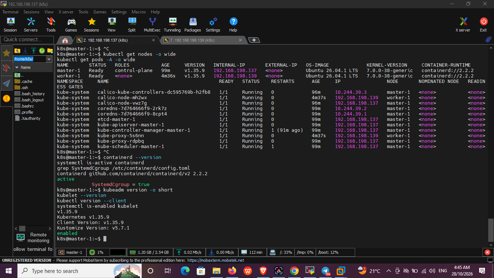

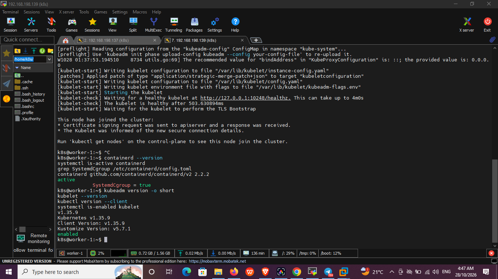

## Step 3: Install kubeadm, kubelet, and kubectl (all nodes)

```bash
sudo mkdir -p -m 755 /etc/apt/keyrings
curl -fsSL https://pkgs.k8s.io/core:/stable:/v1.35/deb/Release.key | sudo gpg --dearmor -o /etc/apt/keyrings/kubernetes-apt-keyring.gpg
echo 'deb [signed-by=/etc/apt/keyrings/kubernetes-apt-keyring.gpg] https://pkgs.k8s.io/core:/stable:/v1.35/deb/ /' | sudo tee /etc/apt/sources.list.d/kubernetes.list

sudo apt update
sudo apt install -y kubelet kubeadm kubectl
sudo apt-mark hold kubelet kubeadm kubectl
sudo systemctl enable kubelet
```

`apt-mark hold` prevents accidental upgrades of the cluster packages.

Verify (on **both nodes**):

```bash
kubeadm version -o short
kubelet --version
kubectl version --client
systemctl is-enabled kubelet
```

## Step 4: Initialize the control plane (master-1 only)

```bash
sudo kubeadm init \
  --apiserver-advertise-address=192.168.198.137 \
  --pod-network-cidr=10.244.0.0/16
```

The pod CIDR is `10.244.0.0/16` so it does not overlap with the VM network (`192.168.198.0/24`).

The command ends with `Your Kubernetes control-plane has initialized successfully!` and prints the `kubeadm join` command used in Step 7.


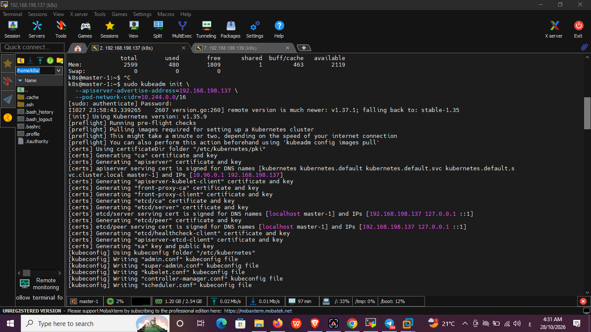

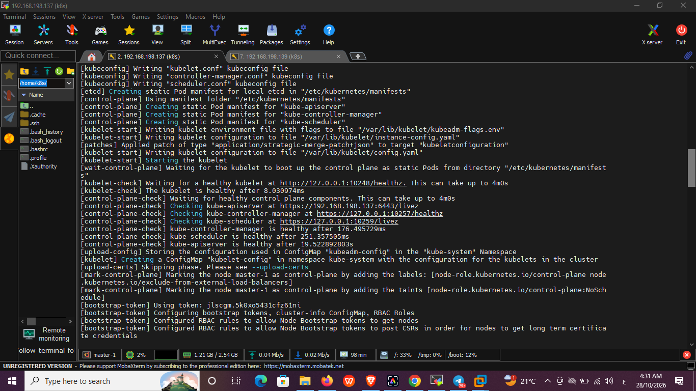

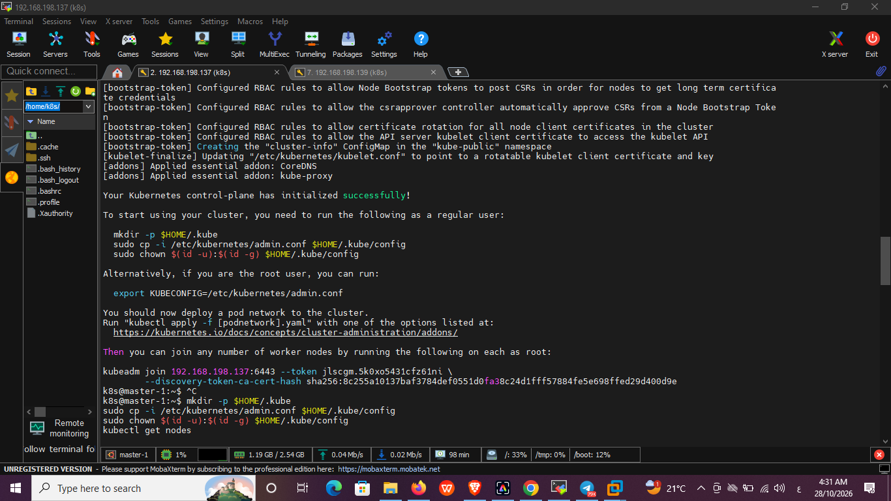

## Step 5: Configure kubectl (master-1 only)

```bash
mkdir -p $HOME/.kube
sudo cp -i /etc/kubernetes/admin.conf $HOME/.kube/config
sudo chown $(id -u):$(id -g) $HOME/.kube/config
```

Verify:

```bash
ls -l ~/.kube/config
kubectl cluster-info
kubectl get nodes
```

At this point `master-1` is `NotReady` because no CNI plugin is installed yet.


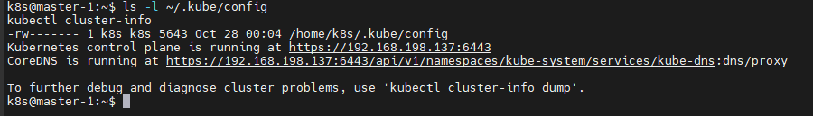

## Step 6: Install the Calico CNI (master-1 only)

```bash
curl -fsSLO https://raw.githubusercontent.com/projectcalico/calico/v3.30.7/manifests/calico.yaml

# Set the pod CIDR to match kubeadm init
sed -i 's|# - name: CALICO_IPV4POOL_CIDR|- name: CALICO_IPV4POOL_CIDR|; s|#   value: "192.168.0.0/16"|  value: "10.244.0.0/16"|' calico.yaml
grep -A1 "name: CALICO_IPV4POOL_CIDR" calico.yaml

kubectl apply -f calico.yaml
kubectl get pods -n kube-system -w
```

Wait until `calico-node`, `calico-kube-controllers`, and `coredns` are all `1/1 Running`. Then:

```bash
kubectl get nodes
```

`master-1` becomes `Ready`.


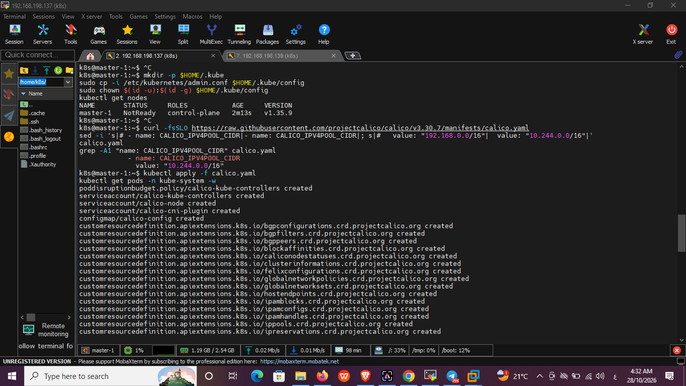

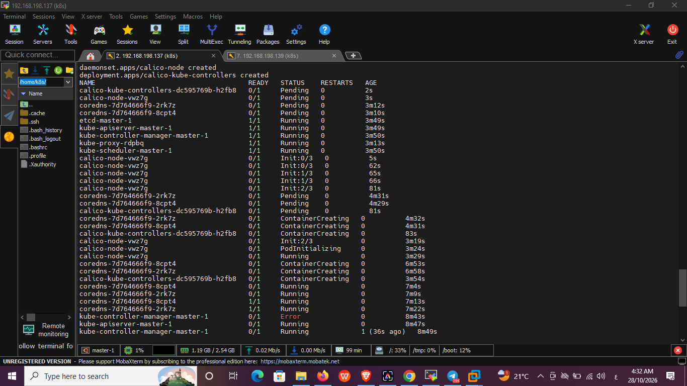

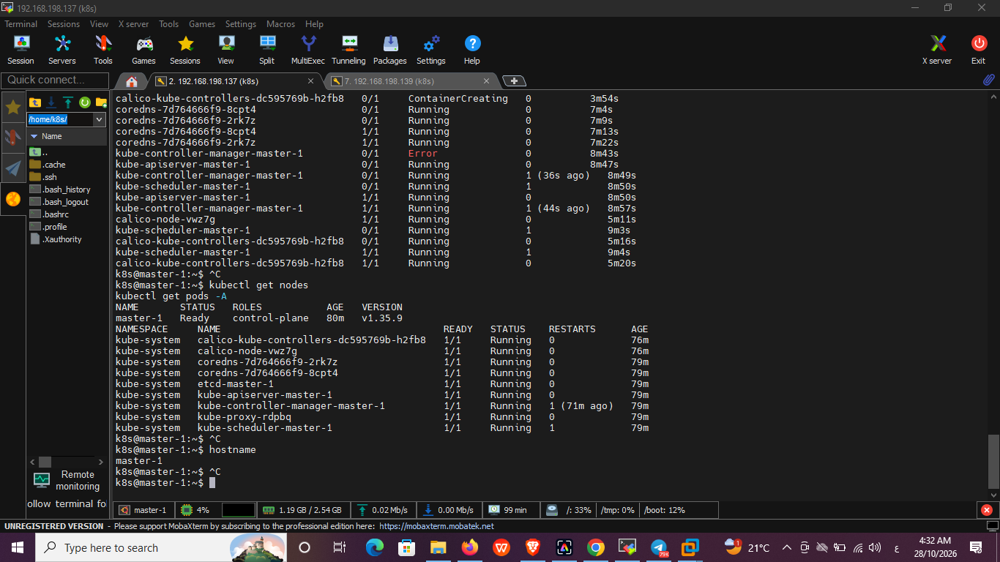

## Step 7: Join the worker node (worker-1 only)

```bash
sudo kubeadm join 192.168.198.137:6443 --token <token> \
  --discovery-token-ca-cert-hash sha256:<hash>
```

Expected output: `This node has joined the cluster`.


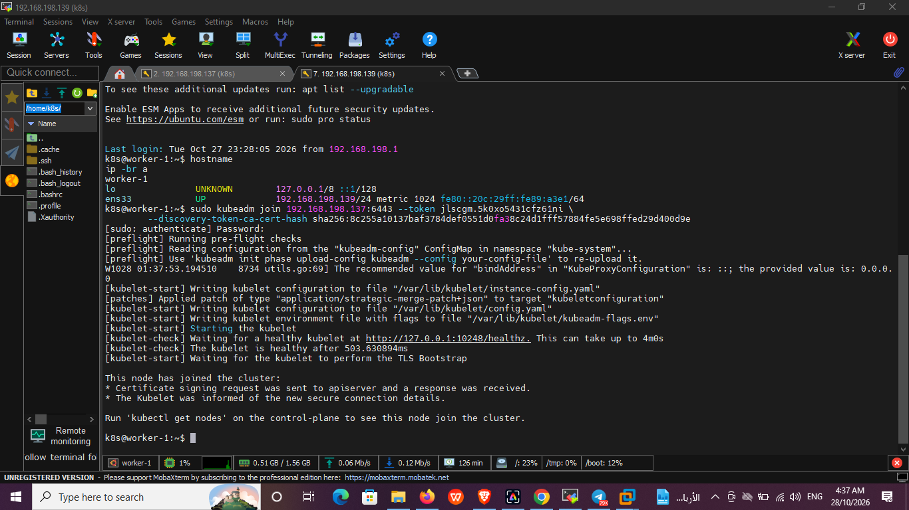

## Step 8: Verify the cluster (master-1)

```bash
kubectl get nodes -o wide
kubectl get pods -A -o wide
```

Result:

- `master-1` and `worker-1` are both `Ready` (v1.35.9, containerd 2.2.2).
- `calico-node` and `kube-proxy` run on both nodes.
- `coredns`, `etcd`, `kube-apiserver`, `kube-controller-manager`, and `kube-scheduler` are `Running`.
- Pod IPs come from the 10.244.0.0/16 range.


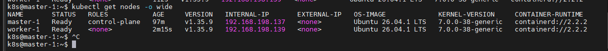

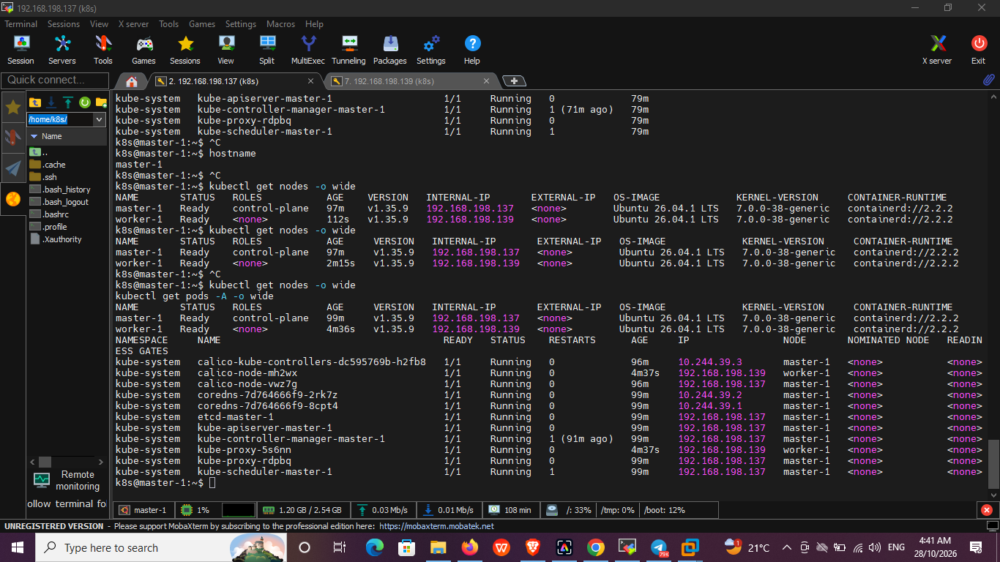

---

## Notes and troubleshooting

- **`kubeadm init` failed with `[ERROR Mem]: the system RAM (1594 MB) is less than the minimum 1700 MB`.** The 2 GB VM only exposed 1594 MB to the OS. I increased `master-1` to 3 GB RAM (the OS then saw 2599 MB) instead of using `--ignore-preflight-errors`.
- **Pod CIDR.** Calico's default pool is `192.168.0.0/16`, which could overlap with the VM network, so `10.244.0.0/16` was used in both `kubeadm init` and the Calico manifest.
- **Cloned worker.** After cloning, the worker's hostname and machine-id were reset before joining:
  ```bash
  sudo hostnamectl set-hostname worker-1
  sudo sed -i 's/master-1/worker-1/g' /etc/hosts
  sudo rm -f /etc/machine-id /var/lib/dbus/machine-id
  sudo systemd-machine-id-setup
  sudo ln -sf /etc/machine-id /var/lib/dbus/machine-id
  sudo reboot
  ```
- **Restart of control-plane pods.** `kube-controller-manager` and `kube-scheduler` restarted once while the Calico images were being pulled and the VM was busy. They were stable afterwards.
- **Token lifetime.** The join token expires after 24 hours. A new one can be created with `kubeadm token create --print-join-command`.
