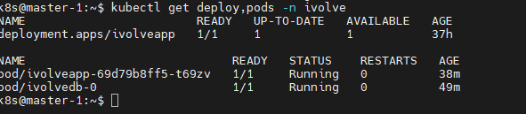
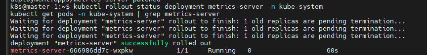
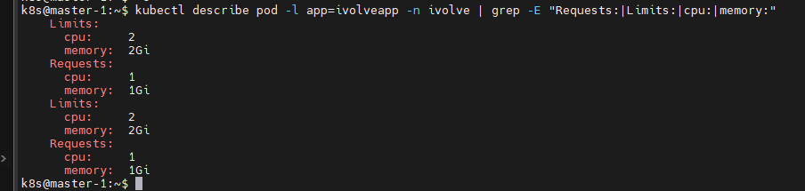
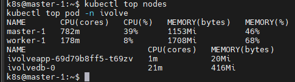

# Lab 16: Pod Resource Management with CPU and Memory Requests and Limits

## Objective
Update the existing `ivolveapp` Deployment (namespace `ivolve`) to include resource requests and limits, then verify them and monitor real-time usage.

| | CPU | Memory |
|---|---|---|
| **Requests** | 1 (1 vCPU) | 1Gi |
| **Limits** | 2 (2 vCPUs) | 2Gi |

## Steps

### 1. Check the current state
```bash
kubectl get deploy,pods -n ivolve
```


### 2. Apply requests and limits
```bash
kubectl set resources deployment ivolveapp -n ivolve \
  --requests=cpu=1,memory=1Gi \
  --limits=cpu=2,memory=2Gi
```
This triggers a rolling update that creates a new pod with the resources applied.

The equivalent section in the Deployment manifest:
```yaml
resources:
  requests:
    cpu: "1"
    memory: 1Gi
  limits:
    cpu: "2"
    memory: 2Gi
```


### 3. Wait for the rollout
```bash
kubectl rollout status deployment ivolveapp -n ivolve
kubectl get pods -n ivolve
```


### 4. Verify requests and limits
```bash
kubectl describe pod -l app=ivolveapp -n ivolve | grep -E "Requests:|Limits:|cpu:|memory:"
```
Output:
```
Limits:
  cpu:     2
  memory:  2Gi
Requests:
  cpu:     1
  memory:  1Gi
Limits:
  cpu:     2
  memory:  2Gi
Requests:
  cpu:     1
  memory:  1Gi
```
The block appears twice because `kubectl set resources` applies the values to **all** containers in the pod (the init container and the application container).



### 5. Monitor real-time usage (metrics-server)
```bash
kubectl top nodes
kubectl top pod -n ivolve
```


## Notes
- `requests` is what the scheduler reserves for the pod on a node; `limits` is the maximum the container may consume (CPU is throttled above the limit, memory above the limit causes OOMKill).
- The cluster nodes have only 2 vCPUs each, so the Deployment was scaled to 1 replica to ensure the pod (requesting 1 CPU) can be scheduled:
  ```bash
  kubectl scale deployment ivolveapp -n ivolve --replicas=1
  ```
- `kubectl top` requires metrics-server to be running in the cluster.
