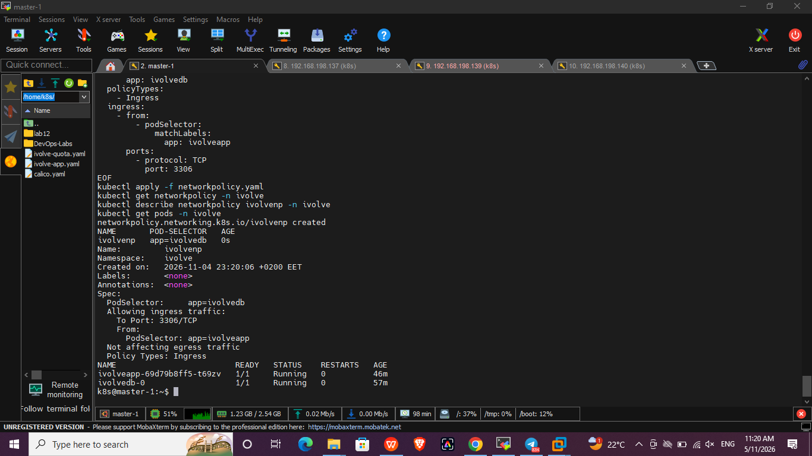
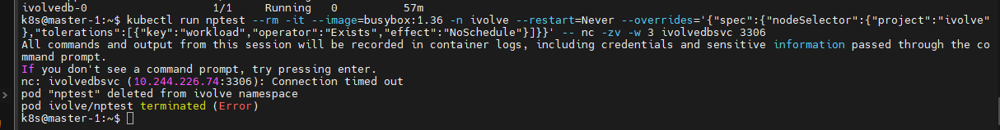

# Lab 17: Control Pod-to-Pod Traffic via Network Policy

## Objective
Create a NetworkPolicy named `ivolvenp` in the `ivolve` namespace that:
- Targets the MySQL pod (`app=ivolvedb`)
- Applies to **Ingress** traffic only
- Allows traffic **only from the application pods** (`app=ivolveapp`) on port **3306**

> Kubernetes object names must be lowercase, so `ivolveNP` is created as `ivolvenp`.

## Steps

### 1. Check the pod labels
```bash
kubectl get pods -n ivolve --show-labels
```
- Application pods: `app=ivolveapp`
- MySQL pod: `app=ivolvedb`

### 2. Create the NetworkPolicy
`networkpolicy.yaml`:
```yaml
apiVersion: networking.k8s.io/v1
kind: NetworkPolicy
metadata:
  name: ivolvenp
  namespace: ivolve
spec:
  podSelector:
    matchLabels:
      app: ivolvedb
  policyTypes:
    - Ingress
  ingress:
    - from:
        - podSelector:
            matchLabels:
              app: ivolveapp
      ports:
        - protocol: TCP
          port: 3306
```

### 3. Apply and verify
```bash
kubectl apply -f networkpolicy.yaml
kubectl get networkpolicy -n ivolve
kubectl describe networkpolicy ivolvenp -n ivolve
kubectl get pods -n ivolve
```


### 4. Test that other pods are blocked
A temporary pod without the `app=ivolveapp` label tries to reach MySQL:
```bash
kubectl run nptest --rm -it --image=busybox:1.36 -n ivolve --restart=Never \
  --overrides='{"spec":{"nodeSelector":{"project":"ivolve"},"tolerations":[{"key":"workload","operator":"Exists","effect":"NoSchedule"}]}}' \
  -- nc -zv -w 3 ivolvedbsvc 3306
```
Result: `Connection timed out`, so the traffic is blocked.

(The `nodeSelector` and `toleration` are only needed because the worker node in this cluster is labeled and tainted.)



## Result
Only pods labeled `app=ivolveapp` can reach the MySQL pod on port 3306. Any other pod in the namespace is denied.
