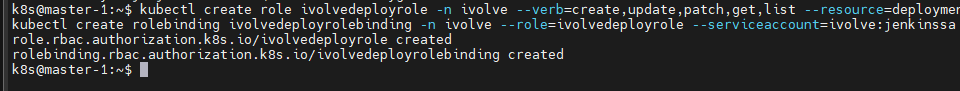
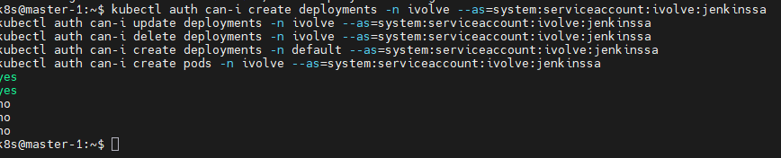

# Lab 19: Securing Kubernetes with RBAC and Service Accounts

## Objective
- Create the `jenkinssa` Service Account in the `ivolve` namespace
- Create a token for it
- Create a Role `ivolvedeployrole` that grants create/update permissions on deployments in `ivolve`
- Bind it with a RoleBinding `ivolvedeployrolebinding`
- Validate that the account can only create/update deployments in the `ivolve` namespace

> Kubernetes object names must be lowercase, so `jenkinsSA`, `ivolveDeployRole` and `ivolveDeployRoleBinding` are created in lowercase.

## Steps

### 1. Create the Service Account and a token
```bash
kubectl create serviceaccount jenkinssa -n ivolve
kubectl create token jenkinssa -n ivolve
```
The token is not included in this repository because it grants access to the cluster.

### 2. Create the Role
```bash
kubectl create role ivolvedeployrole -n ivolve \
  --verb=create,update,patch,get,list \
  --resource=deployments.apps
```

### 3. Create the RoleBinding
```bash
kubectl create rolebinding ivolvedeployrolebinding -n ivolve \
  --role=ivolvedeployrole \
  --serviceaccount=ivolve:jenkinssa
```


### 4. Validate the permissions
```bash
kubectl auth can-i create deployments -n ivolve  --as=system:serviceaccount:ivolve:jenkinssa
kubectl auth can-i update deployments -n ivolve  --as=system:serviceaccount:ivolve:jenkinssa
kubectl auth can-i delete deployments -n ivolve  --as=system:serviceaccount:ivolve:jenkinssa
kubectl auth can-i create deployments -n default --as=system:serviceaccount:ivolve:jenkinssa
kubectl auth can-i create pods        -n ivolve  --as=system:serviceaccount:ivolve:jenkinssa
```

| Check | Result |
|---|---|
| create deployments in `ivolve` | yes |
| update deployments in `ivolve` | yes |
| delete deployments in `ivolve` | no |
| create deployments in `default` | no |
| create pods in `ivolve` | no |



## Notes
- `get`, `list` and `patch` were added to the Role because `kubectl apply` (used later by Jenkins to deploy) needs them in addition to create/update.
- A Role is namespaced, so the permissions apply only inside `ivolve`.
